<div class="summary">
<br/>應用所需：1. 兩台需要互相遠端連線的 Windows 10／11 電腦
<br/>&emsp;&emsp;&emsp;&emsp;&emsp;2. 兩台電腦皆安裝 RustDesk 與 Tailscale
<br/>&emsp;&emsp;&emsp;&emsp;&emsp;3. 兩台裝置加入同一個 Tailnet，或透過 Tailscale Share 授權指定裝置
<br/>解決問題：1. Windows 非專業版的用戶想要遠端控制軟體，並且兼顧私有安全性
<br/>&emsp;&emsp;&emsp;&emsp;&emsp;2. 不依賴 RustDesk 公開 ID／Relay Server，避免電腦資訊連到官方伺服器
<br/>&emsp;&emsp;&emsp;&emsp;&emsp;3. 電腦位於不同網路、沒有固定公網 IP 或處於 NAT 後方，仍能使用私人位址連線
<br/>&emsp;&emsp;&emsp;&emsp;&emsp;4. 透過 Tailscale 身分驗證、加密網路與 Access Policy 限制可連線裝置
<br/>Tailscale 官方教學：<a href="https://tailscale.com/docs/solutions/access-remote-desktops-with-rustdesk">Access remote desktops using RustDesk</a>
<br/>RustDesk 進階設定：<a href="https://rustdesk.com/docs/en/self-host/client-configuration/advanced-settings/">Advanced Settings - Direct IP access</a>
<br/>Tailscale Windows 安裝：<a href="https://tailscale.com/docs/install/windows">Install Tailscale on Windows</a>
<br/>重要觀念：本篇直連時輸入的是 Tailscale `100.x.x.x` 私有 IP，不是 RustDesk 畫面上的九位數公開 ID
<br/>安全提醒：不要將 RustDesk Direct IP 連接埠直接轉發到公網；請搭配 Tailscale 權限與 RustDesk 強密碼使用
<br/>本篇分為 5 大部分。
<br/>第一部分：RustDesk 介紹
<br/>第二部分：問題描述、架構與準備工作
<br/>第三部分：安裝 Tailscale 並建立私人網路
<br/>第四部分：驗證成果 - 設定 RustDesk Direct IP 與安全強化
<br/>第五部分：常見問題 & 討論
</div>

<div class="title">
    <br/><hr class="titleinner">
	<span></span>
	<hr class="titleinner"><br/>
</div>


<br/><br/>
<h1>第一部分：RustDesk 介紹</h1>

<h2>Step 1：RustDesk 是什麼？</h2>
<a href="https://rustdesk.com/">RustDesk</a> 是開源的跨平台遠端桌面工具，能進行畫面控制、剪貼簿同步與檔案傳輸。
<br/>一般使用方式是在控制端輸入遠端電腦顯示的 RustDesk ID，再輸入一次性或固定密碼建立連線。

``` Markdown
控制端 RustDesk
      ↓ 輸入九位數 ID
RustDesk ID Server：協助找到遠端裝置
      ↓ NAT Traversal／Hole Punching
遠端電腦
      ↓ 直連失敗時
RustDesk Relay Server：中繼流量
```

<br/>一般使用者不需要理解伺服器細節就能快速遠端協助，這是 RustDesk 公開 ID 模式的優點。
<br/>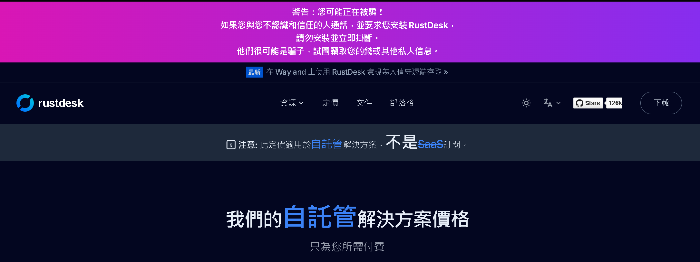
<br/><br/>


<h2>Step 2：RustDesk 的三種常見連線方案</h2>

{:class="table table-bordered"}
| 方案 | 連線識別 | 是否依賴 RustDesk Server | 適合情境 |
| :--- | :--- | :---: | :--- |
| 1. 公開 ID | RustDesk 九位數 ID | 是，使用公開服務 | 臨時協助、快速開始 |
| 2. Tailscale + Direct IP | Tailscale 100.x.x.x 私有 IP | 否 | 自己的多台設備、家人或固定成員 |
| 3. 自架 Server | 自建 ID／Relay Server | 是，自己維護 hbbs／hbbr | 公司管理、完整掌控後端 |

<br/>本篇採用第 2 種方案。RustDesk 負責桌面控制與權限驗證，Tailscale 負責讓兩台裝置在私人加密網路中互相找到。
<br/>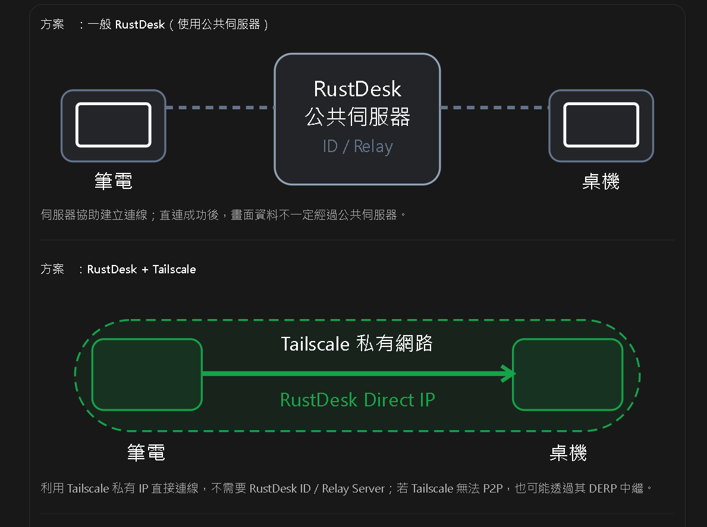
<br/><br/>


<h2>Step 3：標題中的「直連 ID」實際上是 Direct IP</h2>
RustDesk 主畫面的 `Control Remote Desktop` 欄位可以接受公開 ID，也可以在啟用 Direct IP access 後輸入 IP 位址。

``` Markdown
公開模式：輸入 RustDesk ID，例如 58 600 931
本篇模式：輸入 Tailscale IP，例如 100.80.10.20
```

<br/>所以這篇不是把 RustDesk ID 綁定到 Tailscale，而是以穩定的 Tailnet 私有 IP 取代公開 ID 查找流程。
<br/>Tailscale 分配的 **100.x.y.z** 位址會在裝置持續註冊於同一 Tailnet 期間維持穩定，適合建立固定遠端入口。
<br/>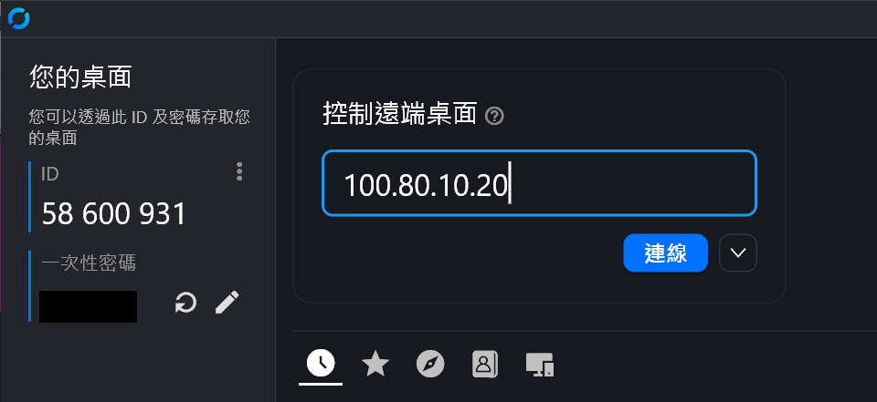
<br/><br/>


<h2>Step 4：為什麼不直接開路由器 Port Forwarding？</h2>
RustDesk Direct IP 預設監聽 TCP `21118`，但不代表應把這個連接埠直接暴露到 Internet。

``` Markdown
不建議：Internet → 公網 IP:21118 → 路由器轉發 → RustDesk

本篇：控制端 → Tailscale 加密 Tailnet → 100.x.x.x:21118 → RustDesk
```

<br/>Tailscale 會先確認裝置身分及 Tailnet 權限，只有獲得授權的節點能接觸這個私人位址。
<br/>因此家用路由器不必設定 Port Forwarding，也不需要申請固定公網 IP 或 Dynamic DNS。
<br/><br/>


<br/><br/>
<h1>第二部分：問題描述、架構與準備工作</h1>

<h2>Step 1：跨網路遠端桌面的困難</h2>
假設控制端是 **外出的筆電**，**遠端端點是家中的桌機** ， 兩台電腦分別位於手機網路與家用 NAT 後方：

``` Markdown
外出筆電                            家中桌機
192.168.x.x → 電信 NAT → Internet ← 分享器 NAT ← 192.168.x.x
```

<br/>兩台電腦的 `192.168.x.x` 都只是各自區域網路的私有位址，不能直接跨 Internet 使用。
<br/>RustDesk 公開 ID Server 可以協助打洞，但失敗時可能改走 Relay
<br/>※自己架 Server 會需要額外維護網域、憑證、防火牆與連接埠
<br/><br/>


<h2>Step 2：Tailscale 如何解決？</h2>
為了簡單、高效、兼具安全性，因此採用 Tailscale + Rustdusk 的方式
<br/>Tailscale 以 WireGuard 為基礎，將登入並取得授權的裝置組成 Tailnet。每台裝置會取得專用的 Tailscale IP：

``` Markdown
外出筆電：100.70.10.11
家中桌機：100.80.20.22

100.70.10.11 ←── Tailscale 加密通道 ──→ 100.80.20.22
```

<br/>即使實際網路位置改變，應用程式仍可使用相同 Tailscale IP 找到裝置。
<br/>Tailscale 會盡量建立 點對點(Peer-to-Peer) 連線
<br/>若 NAT 環境無法直連，則可能使用 DERP Relay 傳送仍經端對端加密的封包。
<br/><br/>


<h2>Step 3：完整工作流架構</h2>

``` Markdown
控制端 Windows
├─ Tailscale：登入 Tailnet
└─ RustDesk：輸入 100.x.x.x
             │
             │ Tailscale 加密通道
             ↓
遠端 Windows
├─ Tailscale：登入同一 Tailnet／接受 Share
└─ RustDesk：Enable direct IP access
             └─ TCP 21118
```

<br/>這個方案繞過 RustDesk ID／Relay 基礎設施，但沒有移除 RustDesk 的密碼與桌面操作權限。
<br/>必須同時通過 Tailscale 網路存取與 RustDesk 驗證，才能真正控制桌面。
<br/><br/>


<h2>Step 4：開始前準備清單</h2>

{:class="table table-bordered"}
| 項目 | 控制端 | 遠端端點 |
| :--- | :---: | :---: |
| Windows 10／11 | ✓ | ✓ |
| 安裝 Tailscale | ✓ | ✓ |
| 安裝 RustDesk | ✓ | ✓ |
| 加入 Tailnet／接受 Share | ✓ | ✓ |
| Enable direct IP access | 選用 | 必須 |
| RustDesk 存取密碼 | 需要知道 | 設定或顯示 |
| 保持電腦開機與網路連線 | ✓ | ✓ |

<br/>第一次設定時建議 **兩台電腦都在身邊** ，確定開機啟動、權限與防火牆正常後，再從外部網路測試。
<br/><br/>


<br/><br/>
<h1>第三部分：安裝 Tailscale 並建立私人網路</h1>

<h2>Step 1：建立 Tailnet</h2>
進入 <a href="https://login.tailscale.com/admin">Tailscale Admin Console</a>，以自己的身分提供者登入。
<br/>第一次登入後會建立 Tailnet，後續可在 `Machines` 管理所有裝置與私人 IP。

``` Markdown
Tailnet：由 Tailscale 管理的私人裝置網路
Machine：加入 Tailnet 的電腦、手機、伺服器或 NAS
```

<br/>選擇 Email 或自己熟悉的方式註冊建立
<br/>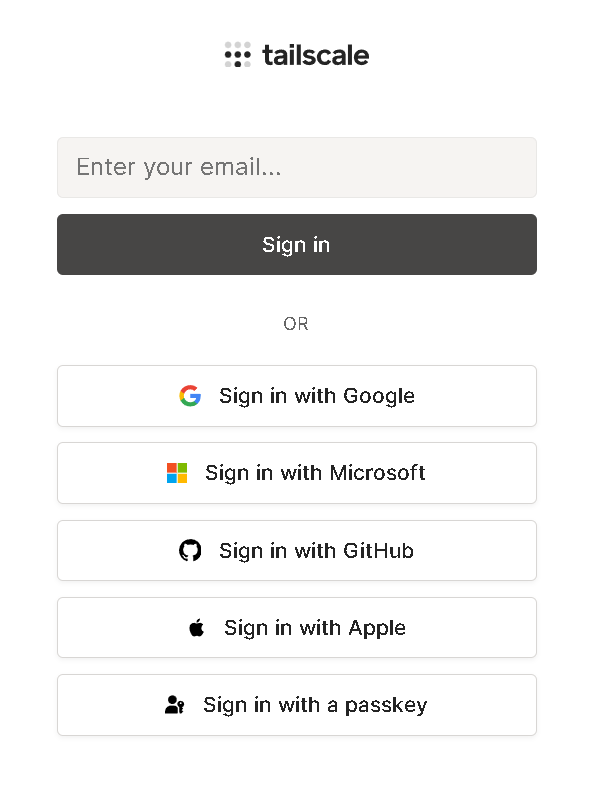
<br/><br/>


<h2>Step 2：在兩台 Windows 安裝 Tailscale</h2>
進入 <a href="https://tailscale.com/download/windows">Tailscale Windows Download</a>，下載並執行 `.exe` 安裝程式。

``` Markdown
控制端：安裝 → 系統匣 Tailscale 圖示 → Log in
遠端端點：安裝 → 系統匣 Tailscale 圖示 → Log in
```

<br/>Windows 版目前需要 Windows 10 以上或 Windows Server 2016 以上。
<br/>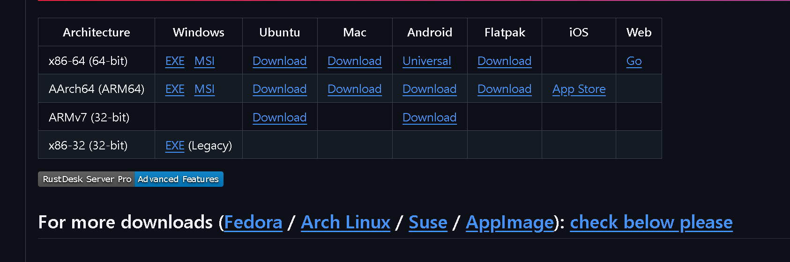
<br/>
<br/>確保兩台電腦都安裝完成
<br/>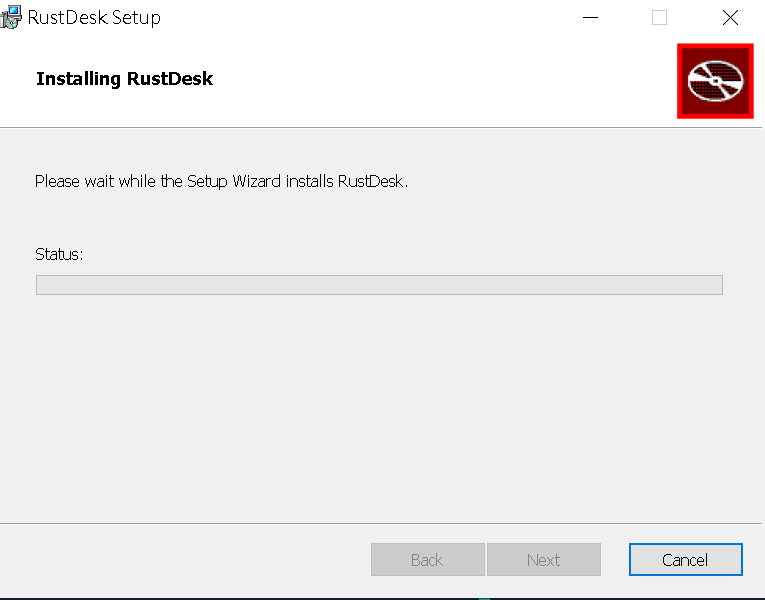
<br/><br/>


<h2>Step 3：在兩台 Windows 安裝 Tailscale</h2>
完成登入後，回到 Admin Console 的 `Machines`，確認兩台裝置都顯示 Connected。
<br/>Windows 的右下角有常駐軟體的 Icon 顯示
<br/>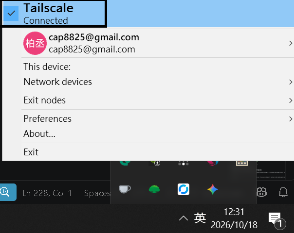
<br/><br/>


<h2>Step 4：取得遠端電腦的 Tailscale IP</h2>
在 `Machines` 找到遠端電腦，複製 Addresses 欄位的 IPv4 (舉例，可搭配圖)：

``` Markdown
Remote-PC
100.80.20.22
```

<br/>請記錄遠端端點的 Tailscale IP，而不是家中 `192.168.x.x`、公網 IP 或 Tailscale DNS Server `100.100.100.100`。
<br/>把 **控制端** 、 **遠端端點** 記錄下來
<br/>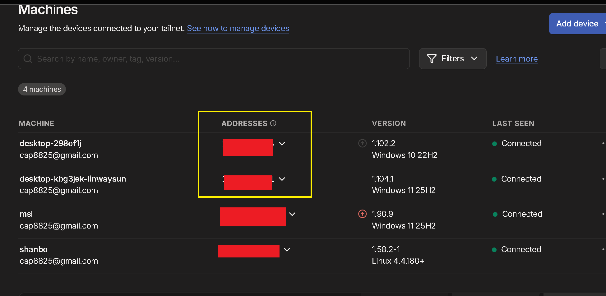
<br/><br/>


<br/><br/>
<h1>第四部分：驗證成果 - 設定 RustDesk Direct IP 與安全強化</h1>

<h2>Step 1：在兩台電腦安裝 RustDesk</h2>
進入 <a href="https://rustdesk.com/">RustDesk 官方網站</a>下載 Windows 版本，至少要在遠端端點完成安裝。
<br/>若只執行 Portable 版本，重新登入、鎖定畫面或 UAC 提權時可能受到限制；
<br/>需要長期無人值守時，建議完成服務安裝並設定開機啟動。

``` Markdown
控制端：負責發起遠端桌面連線
遠端端點：持續執行 RustDesk，等待 TCP 21118 Direct IP 連線
```

<br/>
<br/><br/>


<h2>Step 2：遠端端點配置 - 啟用直接連線IP設定</h2>
在遠端端點開啟 RustDesk：

``` Markdown
設定 → 安全 → 啟用 IP 直接存取 → 套用
```

<br/>※保持預設 TCP `21118` 可以減少設定差異。若修改 Port，控制端、防火牆與 Access Policy 也要使用相同數值。
<br/>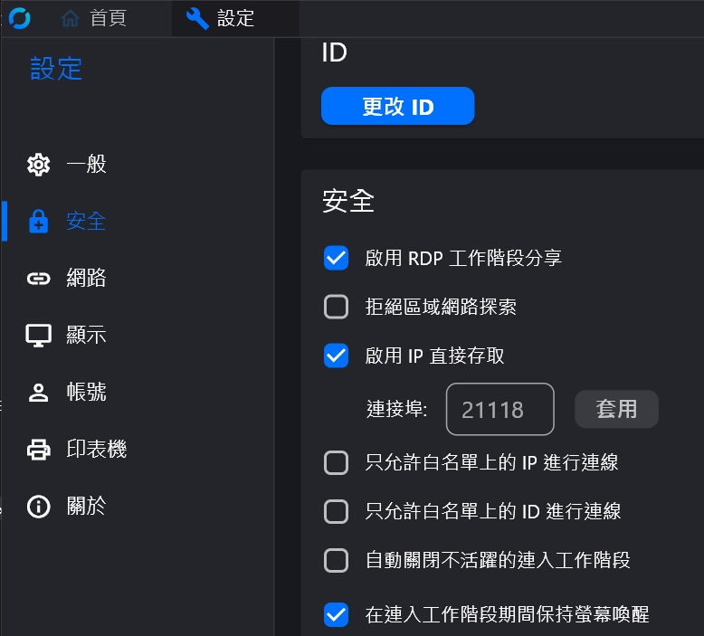
<br/><br/>


<h2>Step 3：遠端端點配置 - 設定遠端存取密碼</h2>
如果遠端電腦旁有人，可以使用畫面左上的 **一次性密碼**
<br/>但因為我們是 Tailscale + Rustdusk ，因此可以讓遠端電腦保持開啟，設定 **固定密碼** 更方便(遠端被控制的電腦不用按下接收控制)：

``` Markdown
設定 → 安全 → 固定密碼 → 設定 
```

<br/>
<br/>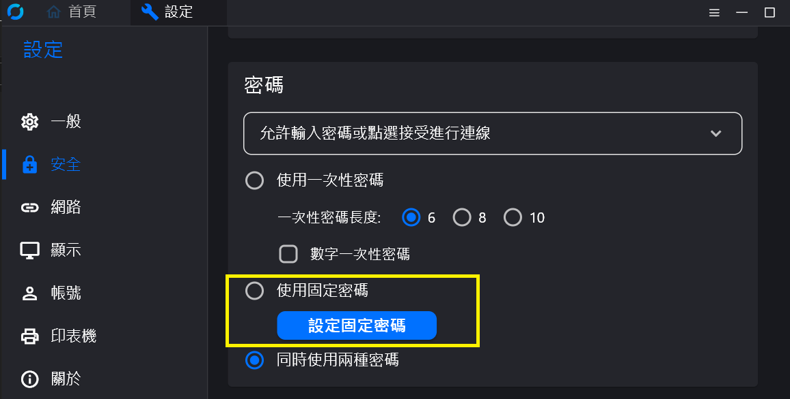
<br/>
<br/>設定固定密碼
<br/>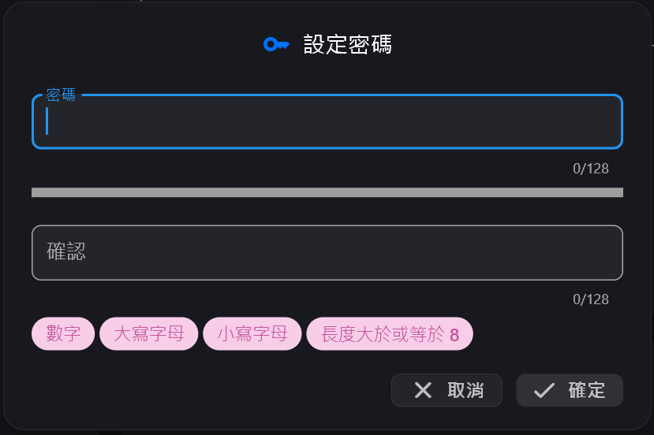
<br/><br/>


<h2>Step 4：控制端配置 - 使用 Tailscale IP 連線</h2>
回到控制端 RustDesk，在 **遠端控制** 欄位輸入 IP：

``` Markdown
EX: 100.80.10.20
```

<br/>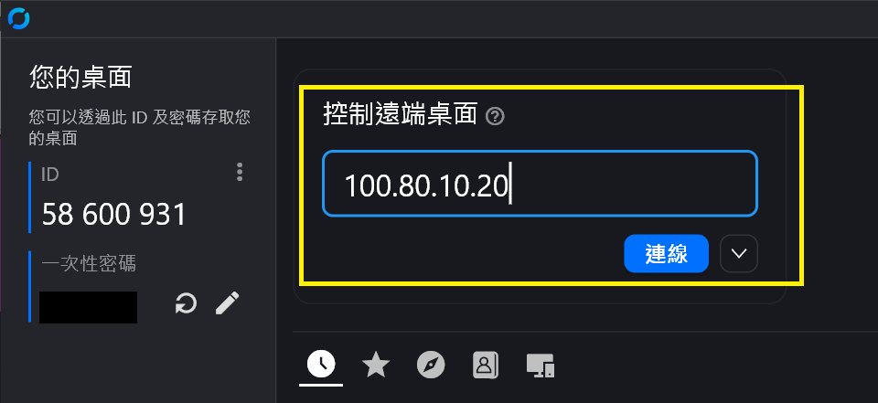
<br/>
<br/>按下 Connect，出現驗證視窗後輸入遠端端點的 RustDesk 一次性或固定密碼。
<br/>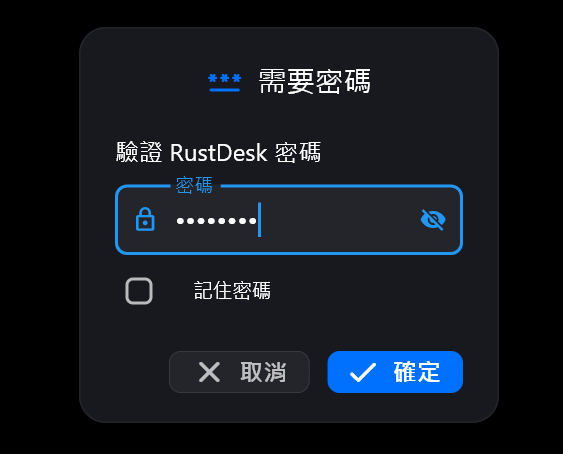
<br/>
<br/>這樣就打通連線了
<br/>
<br/><br/>


<br/><br/>
<h1>第五部分：常見問題 & 討論</h1>


<h2>問題 1：Tailscale 看得到裝置，但 RustDesk 無法連線</h2>

``` Markdown
檢查順序：
1. 遠端 RustDesk 是否正在執行
2. Enable direct IP access 是否開啟
3. Direct IP Port 是否為 21118
4. Test-NetConnection 是否成功
5. Windows Firewall 是否允許 RustDesk
6. Tailscale Policy 是否阻擋 TCP 21118
```

<br/>如果 `tailscale ping` 成功、TCP 測試失敗，問題通常在 RustDesk Listener 或遠端防火牆，而不是 Tailscale 登入。
<br/><br/>


<h2>問題 2：輸入 192.168.x.x 可以在家用，外出卻失敗</h2>
`192.168.x.x` 是區域網路位址，只能在相同 LAN 或具備對應 Subnet Route 時使用。
<br/>跨網路連線應輸入遠端 Tailscale 分配的：

``` Markdown
100.x.x.x
```

<br/>不要輸入 ISP 公網 IP，也不需要在路由器設定 `21118` Port Forwarding。
<br/><br/>


<h2>問題 3：重新安裝 Tailscale 後 IP 改變</h2>
Tailscale IP 在裝置持續註冊期間通常穩定，但以下操作可能取得新位址：

``` Markdown
- 從 Tailnet 移除後重新加入
- Reset／重新安裝並失去 Node Key
- 重灌系統或清除裝置資料
- 管理員修改 IP Pool 或手動調整位址
```

<br/>若經常記不住 IP，可以在連線驗證完成後啟用 MagicDNS，並為裝置設定清楚的 Machine Name。
<br/><br/>


<h2>問題 4：這個方案能完全取代 RustDesk 伺服器嗎？</h2>

{:class="table table-bordered"}
| 需求 | Tailscale + Direct IP | 自架 RustDesk Server |
| :--- | :---: | :---: |
| 少量固定裝置互連 | 適合 | 可用但設定較多 |
| 不開公網 Port | 適合 | 通常仍需公開服務入口 |
| 完整 ID／Relay 基礎設施 | 不需要 | 提供 |
| 大量使用者與集中管理 | 能做部分 Policy 管理 | Pro 功能更完整 |
| 臨時支援陌生使用者 | 需邀請／分享 Tailscale | 公開 ID 較直覺 |

<br/>**自己的設備、家人電腦或固定小團隊很適合本篇方案**
<br/>大量端點、企業稽核或需集中式通訊錄時，仍應評估 RustDesk Server Pro 或其他企業遠端管理工具。
<br/><br/>


<h2>總結</h2>
這篇透過 Tailscale 建立私人加密網路，再啟用 RustDesk Direct IP access，完成不依賴 RustDesk 公開 ID／Relay Server 的跨網路遠端桌面。

``` Markdown
最終流程：
1. 兩台電腦安裝並登入 Tailscale
2. 加入同一 Tailnet，或 Share 指定遠端裝置
3. 記錄遠端 100.x.x.x
4. 在遠端 RustDesk 開啟 Direct IP access，Port 21118
5. 設定 RustDesk 一次性或固定密碼
6. 控制端 RustDesk 輸入 Tailscale IP
```

<br/>只要使用的是 Tailnet 私有 IP，流量仍受 Tailscale 身分控制與加密保護
<br/>※記住 : 不需要把 RustDesk Port 暴露到網際網路
<br/><br/>
