<div class="summary">
<br/>適用對象：使用 Synology NAS 的個人或群體
<br/>事件背景：2026 年 10 月底出現 Synology NAS 檔案遭加密並被要求支付贖金的通報
<br/>解決問題：1. 如何判斷自己的 NAS 是否可能已經受害
<br/>&emsp;&emsp;&emsp;&emsp;&emsp;2. 沒有發現受害跡象時，應如何修補弱點並保留遠端存取功能
<br/>&emsp;&emsp;&emsp;&emsp;&emsp;3. 如何區分媒體報導、官方已證實事實與尚未證實的攻擊途徑
<br/>HKEPC 報導：<a href="https://www.hkepc.com/27124">Synology NAS 驚爆大規模勒索攻擊</a>
<br/>Synology 官方聲明：<a href="https://www.synology.com/zh-hk/company/news/article/C3RB3R">Synology 呼籲盡速更新 DSM，避免過時版本暴露於風險</a>
<br/>DSM 安全公告：<a href="https://www.synology.com/en-global/security/advisory/Synology_SA_24_20">Synology-SA-24:20 DSM（PWN2OWN 2024）</a>
<br/>PHP2Shell 官方說明：<a href="https://www.synology.com/en-global/company/news/article/php2shell/">Synology Extends PHP2Shell Security Updates</a>
<br/>資料核對日期：2026 年 11 月 1 日；後續若官方更新調查結果，應以最新公告為準
<br/>基本介紹：本篇分為 3 大部分。
<br/>第一部分：問題分析
<br/>第二部分：檢查 NAS 與排查方法
<br/>第三部分：如何防患未然 - 保護好自己的 NAS
</div>

<div class="title">
    <br/><hr class="titleinner">
	<span></span>
	<hr class="titleinner"><br/>
</div>


<br/><br/>
<h1>第一部分：問題分析</h1>

<h2>Step 1：這次發生了什麼事？</h2>
2026 年 10 月 29 日，HKEPC 報導有 Synology NAS 使用者發現共享資料夾、資料庫映像檔及備份檔遭到加密
<br/>檔名被加上 **`.L0CK3D` 或 `.L0CK3D.`**，目錄內並出現包含 **C3RB3R INSTRUCTIONS** 的 **read-me3.txt** 勒索信。
<br/>同日，Synology 發布正式聲明，確認攻擊者正在利用一個 **2024 年 12 月已完成修補的 DSM 弱點**，鎖定仍在執行過時 DSM 的裝置， **目的為加密資料並勒索贖金。**

``` Markdown
官方已確認的核心問題：
仍在使用含有已知弱點的舊版 DSM

官方提出的核心修補方式：
立即將 DSM 更新至安全版本，並啟用自動更新
```

<br/>HKEPC 對應報導：<a href="https://www.hkepc.com/27124">Synology NAS 驚爆大規模勒索攻擊高危漏洞直攻底層 檔案加密成 .L0CK3D</a>
<br/>對應 Synology 官方聲明(如圖)：<a href="https://www.synology.com/zh-hk/company/news/article/C3RB3R">Synology 呼籲盡速更新 DSM，避免過時版本暴露於風險</a>
<br/>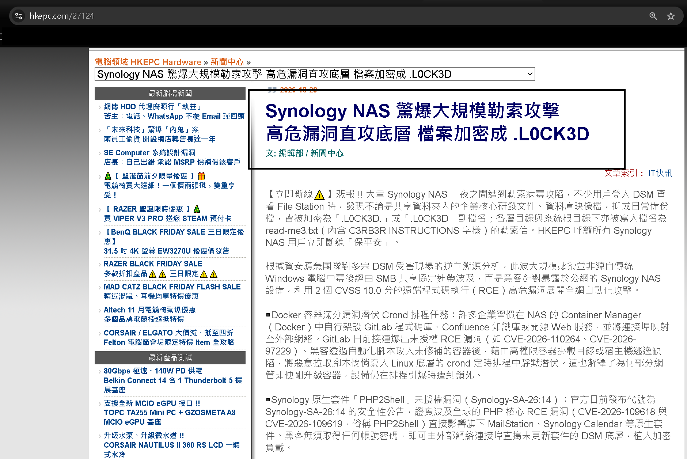
<br/><br/>


<h2>Step 2：媒體報導與官方聲明有哪些差異？</h2>
HKEPC 報導進一步把 Docker／GitLab 弱點與 PHP2Shell 描述成這波攻擊可能使用的入口
<br/>但截至本文核對日期： Synology 的 C3RB3R 正式聲明並沒有證實這兩條攻擊鏈， **而是指向 2024 年已修補的 DSM 弱點與 `Synology-SA-24:20`** 。

{:class="table table-bordered"}
| 項目 | 目前可確認程度 | 說明 |
| :--- | :---: | :--- |
| 有 NAS 檔案遭加密及勒索 | 已確認 | HKEPC 受害通報與 Synology 官方聲明均指出有勒索攻擊 |
| 攻擊鎖定過時 DSM | 官方已確認 | Synology 明確表示攻擊者利用 2024 年 12 月已修補的弱點 |
| `Synology-SA-24:20` 與事件相關 | 官方已確認 | Synology 在聲明中直接要求參考此安全公告 |
| PHP2Shell 是這波勒索攻擊入口 | 尚未證實 | PHP2Shell 是另一項真實弱點，但官方 C3RB3R 聲明未把它確認為本次入侵途徑 |
| Docker／GitLab 容器是這波攻擊入口 | 尚未證實 | 公開容器本來就可能有風險，但不能據此認定所有受害者皆由容器入侵 |
| Synology Drive Server 是本次入口 | 沒有證據 | 官方另說明 Synology Drive 不受 PHP2Shell 影響，不應與第三方 IDrive 混淆 |

<br/>這不表示 Docker 或 PHP 套件不必更新，而是 **不能把另一個真實存在的弱點，直接當成本次事件已被證實的根因。**
<br/><br/>


<h2>Step 3：HKEPC 的「立即斷線」建議是不是很糟糕？</h2>
答案 => **取決於 NAS 是否已經受害(被勒索)。**

{:class="table table-bordered"}
| 狀態 | 斷線是否合理 | 正確目的 |
| :--- | :---: | :--- |
| 已發現檔案被大量改名、勒索信或異常加密 | 合理，而且應立即隔離 | 阻止加密程序繼續存取其他磁碟、電腦、同步端與備份 |
| 有高度可疑行為，但尚未確認感染 | 可先限制網路，進行鑑識 | 降低擴散風險，同時保存日誌與現況 |
| 沒有受害跡象，只是 DSM 過時 | 不適合當長期方案 | 應先縮小外部入口、完成備份並儘快更新 DSM |
| 已更新且檢查正常 | 沒必要永久離線 | 以 VPN／Tailscale、最小權限、MFA 與備份維持安全遠端存取 |

<br/>因此，拔除網路線不是錯誤動作，問題在於：

``` Markdown
把 「事故發生後的緊急隔離」 當成所有使用者永久防禦 NAS 的方法
斷網能暫時阻斷連線，卻不會修補弱點，也無法讓已被加密的資料自動復原。
```

<br/>
<br/>如果沒有受到勒索，表示 **值得檢查並提升防護力以避免後續受到攻擊，也可以安全放心地享用 NAS 的服務** 
<br/><br/>


<h2>Step 4：補充 - 2FA 不能解決 PHP 或 DSM 漏洞</h2>
2FA／MFA 主要 **保護正常的帳號登入流程**
<br/>如果攻擊者利用遠端程式碼執行弱點繞過登入，便不一定需要帳號、密碼或第二因素。

{:class="table table-bordered"}
| 攻擊方式 | 2FA 是否有幫助 |
| :--- | :---: |
| 密碼遭猜中、撞庫或釣魚外洩 | 有，通常能阻止只持有密碼的人登入 |
| 預設 `admin` 帳號被自動化嘗試 | 有幫助，但仍應停用預設帳號 |
| 未修補弱點允許未登入攻擊者執行程式 | 無法取代安全更新 |
| 已登入工作階段或裝置遭竊用 | 不一定能阻止 |

``` Markdown
正確觀念：
2FA 保護帳號，更新修補程式漏洞，備份降低資料損失。
三者處理的是不同風險，不能互相取代。
```

<br/><br/>


<h2>Step 5：這次事件 & 關鍵防禦做法</h2>
`Synology-SA-26:14` 是 Critical 等級的 PHP2Shell 公告，影響特定版本的 PHP、Mail Station 與 Synology Calendar。
<br/>Synology 後續說明，風險集中在使用特定 PHP 相依套件的系統，例如： **Web Station、WordPress、phpMyAdmin、MediaWiki、Joomla、MailStation 與 Calendar 等。**

<br/>官方也明確說明：第三方套件 **IDrive** 受影響，但 **Synology Drive 不受 PHP2Shell 影響**
<br/>DSM 內部使用的 PHP 元件沒有對外模組，官方評估其暴露風險極低。

``` Markdown
有安裝受影響 PHP 套件：
除了更新 DSM，也要在套件中心更新 PHP 與相依套件。

沒有安裝受影響套件：
不代表 DSM 可以不更新；本次 C3RB3R 官方聲明指向的是舊版 DSM 弱點。
```

<br/>簡言之： 
<br/>**1. 這次事件** ： 有安裝 PHP 套件 -> 受到影響 -> 升級 PHP 套件版本(更新至已修補版本)
<br/>**2. Synology 官方聲明相關的 C3RB3R** ： 升級 DSM 版本(更新至已修補版本)
<br/>※依照官方的聲明，沒有證據證明 PHP 漏洞就是 C3RB3R 勒索攻擊的來源，但我們可以先這樣防禦
<br/>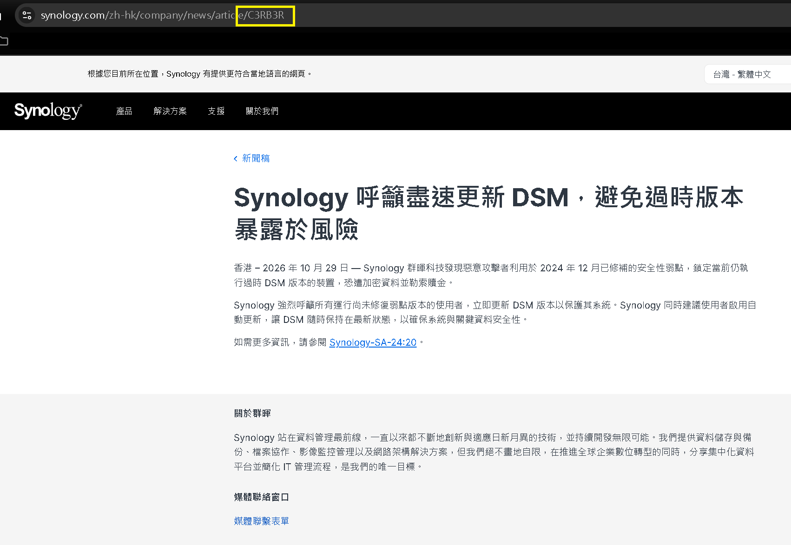
<br/><br/>


<h2>Step 6：Synology-SA-24:20 DSM 的最低修補版本</h2>
<a href="https://www.synology.com/zh-tw/security/advisory/Synology_SA_24_20">官方公告列出</a> 的最低修補版本如下：
<br/>這張表適合用來判斷舊系統是否低於當時修補門檻，但不應把「剛好達到最低版本」當成長期更新策略
<br/>應優先安裝機型目前支援的最新安全版本(實務上如果更新到最新，有可能導致現有的套件失去應用)。

{:class="table table-bordered"}
| DSM 分支 | `Synology-SA-24:20` 最低修補版本 |
| :--- | :--- |
| DSM 7.2.2 | `7.2.2-72806-1` 或以上 |
| DSM 7.2.1 | `7.2.1-69057-6` 或以上 |
| DSM 7.2 | `7.2-64570-4` 或以上 |
| DSM 7.1 | `7.1.1-42962-7` 或以上 |
| DSM 6.2 | `6.2.4-25556-8` 或以上 |

<br/>※若機型已停止支援、無法取得必要修補，應把它視為需要汰換或轉為隔離用途的設備，不應繼續直接暴露於網際網路。
<br/>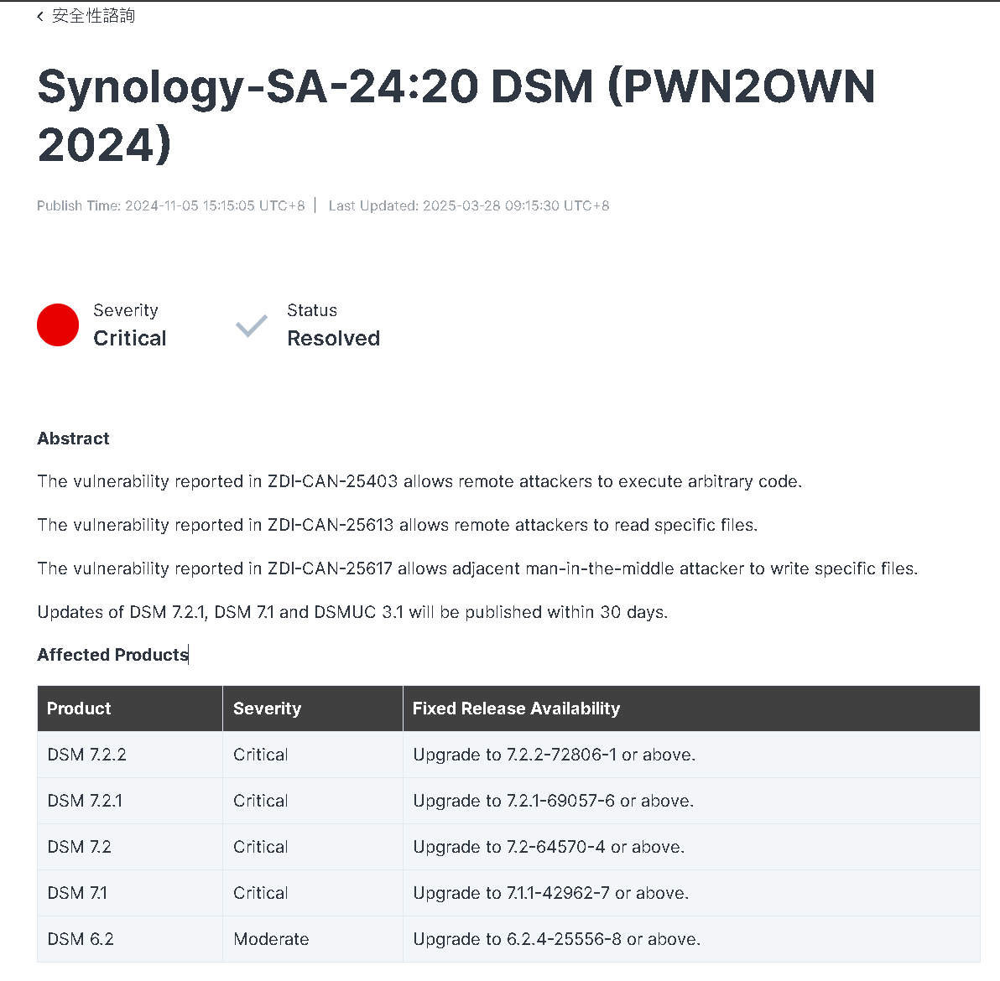
<br/><br/>

<h2>Step 7：Synology-SA-24:20 PHP 的最低修補版本</h2>
關於 PHP2Shell <a href="https://www.synology.com/zh-tw/security/advisory/Synology_SA_26_14">官方公告列出</a> 的最低修補版本如下：
<br/>同上這是針對哪些 PHP／套件版本受影響。

{:class="table table-bordered"}
| 產品 | 嚴重性 | 可用版本
| :--- | :--- |
| Synology Calendar | 危機 | Upgrade to 3.0.4-21435 or above. |
| Mail Station | 危機 | Upgrade to 30000002.3.19-20333 or above. |
| PHP 7.3 | 危機 | 已停止維護，請捨棄 |
| PHP 7.4 | 危機 | Upgrade to 7.4.33-0131 or above. (DSM 7.2 or above) |
|         |      | Upgrade to 7.4.33-0122 or above. (DSM 7.0 – 7.1)
|         |      | Upgrade to 7.4.33-0010 or above. (DSM 6.2) |
| PHP 8.0 | 危機 | Upgrade to 8.0.30-0122 or above. (DSM 7.2 or above) |
|         |      | Upgrade to 8.0.30-0104 or above. (DSM 7.0 – 7.1) |
| PHP 8.1 | 危機 | Upgrade to 8.1.34-0120 or above. |
| PHP 8.2 | 危機 | Upgrade to 8.2.35-0171 or above. |
| PHP 8.3 | 危機 | Upgrade to 8.3.36-0051 or above. |
| PHP 8.4 | 危機 | Upgrade to 8.4.27-0051 or above. |

<br/>※再次補充：若機型已停止支援、無法取得必要修補，應把它視為需要汰換或轉為隔離用途的設備，不應繼續直接暴露於網際網路。
<br/>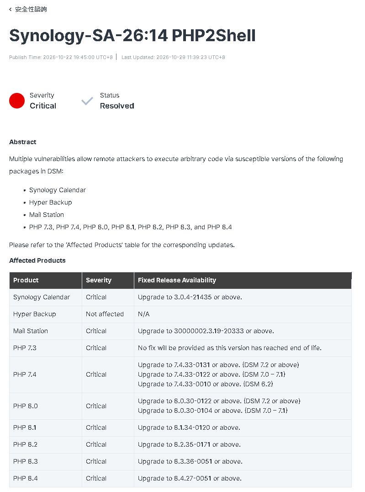
<br/><br/>


<br/><br/>
<h1>第二部分：檢查 NAS 與排查方法</h1>

<h2>Step 1：先判斷自己屬於哪一種狀態</h2>
不要一看到新聞就立即重設 NAS。先依照目前現象分成三種狀態，後面的處理順序會完全不同。

{:class="table table-bordered"}
| 狀態 | 判斷條件 | 下一步 |
| :--- | :--- | :--- |
| 1. 已確認受害 | 出現勒索信、`.L0CK3D`、大量檔案無法開啟或異常改名 | 立即隔離，保存證據，不要急著更新或重灌 |
| 2. 高度可疑 | 不明管理員、異常登入、未知排程／容器、CPU 或磁碟持續異常 | 限制網路，匯出日誌，尋求 Synology 或資安人員協助 |
| 3. 尚未發現受害 | 檔案正常、無可疑登入與異常程序，但版本可能過時 | 完成備份、縮小攻擊面、更新 DSM 與套件 |

<br/><br/>


<h2>Step 2：檢查是否勒索 - 進入 NAS 掃瞄檢查</h2>
進入 NAS -> 左上角選擇所有項
<br/>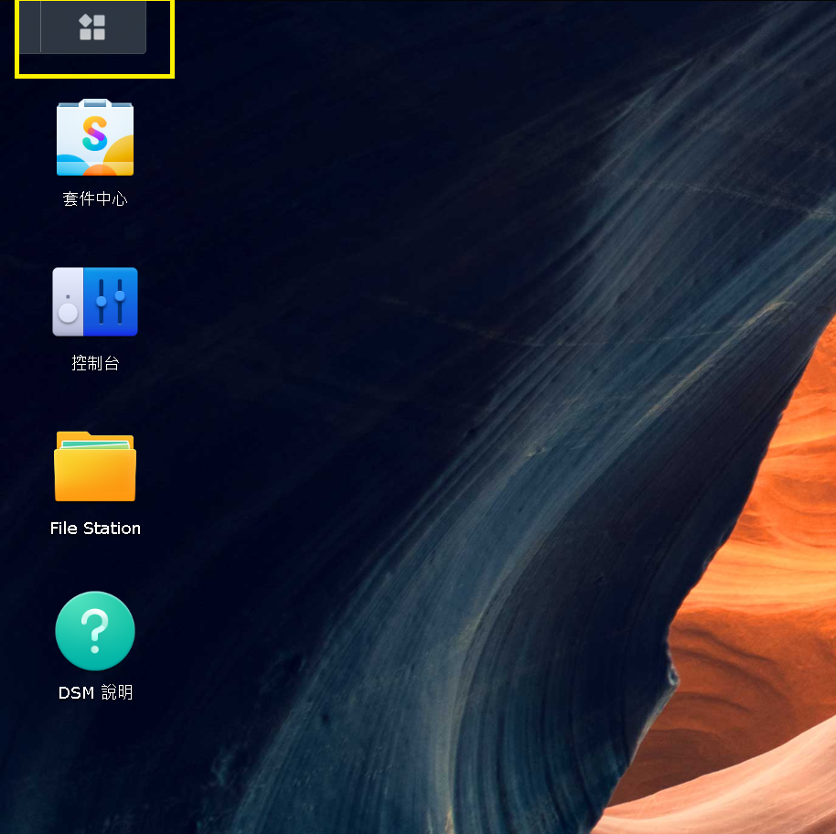
<br/>
<br/>開啟安全諮詢中心
<br/>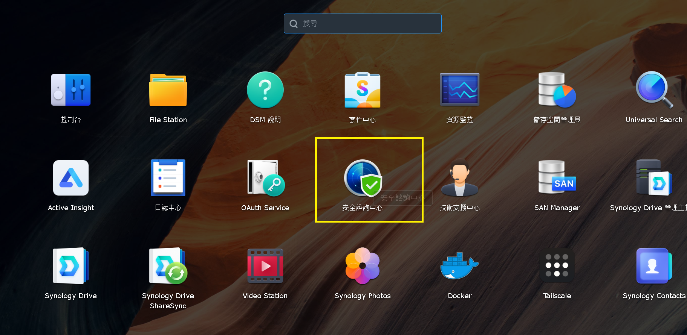
<br/>
<br/>進行掃描檢查是否有異常
<br/>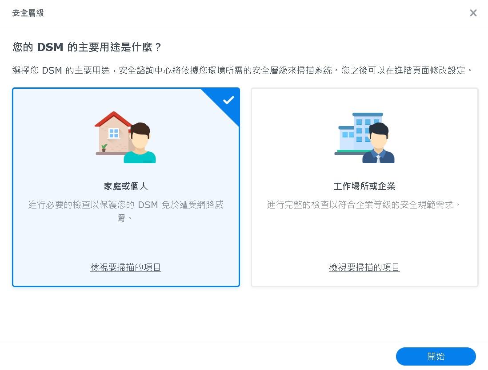
<br/>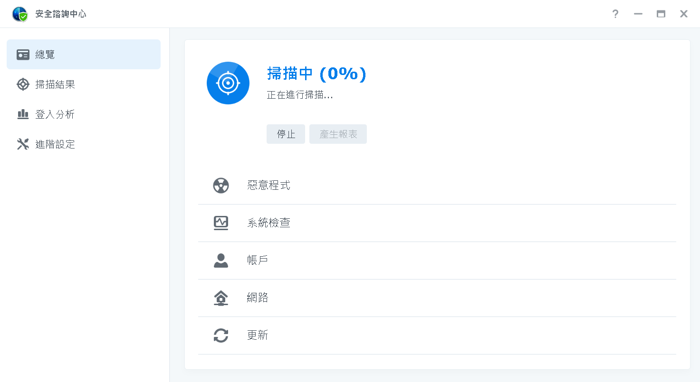
<br/><br/>


<h2>Step 3：檢查是否勒索 - 掃描結果 & 檢查檔案</h2>
掃描後如果 **惡意程式** 、 **運作不正常**，並且 **檢查 NAS 空間的檔案出現 .L0CK3D** 的狀況
<br/>很遺憾，這篇後面的防護可以不用看了，應立即隔離，保存證據，保護自己。(HKEPC 的建議斷開網路等建議執行)
<br/>**亡羊補牢的方式參考看看**：

``` Markdown
1. 從路由器與交換器隔離 NAS，必要時拔除網路線
2. 暫停可將損壞檔案同步到其他位置的工作
3. 不刪除勒索信，不格式化磁碟，不重建儲存空間
4. 記錄發現時間、異常畫面、受影響資料夾及當時執行中的服務
5. 保留 NAS、路由器、防火牆、登入、容器與檔案傳輸日誌
6. 從另一台乾淨裝置變更可能外洩的密碼與撤銷工作階段
7. 聯絡 Synology Support、資訊人員或熟悉鑑識的資安人員
```

<br/>若無法透過網路完成隔離，可考慮關機阻止持續加密
<br/>但關機會失去記憶體中的暫存證據。公司或重要資料環境應先由資安人員評估，家庭使用者則以阻止持續破壞為優先。
<br/>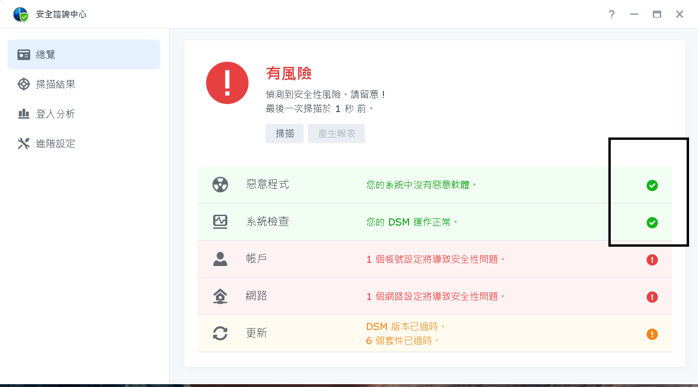
<br/><br/>


<br/><br/>
<h1>第三部分：如何防患未然 - 保護好自己的 NAS</h1>


<h2>Step 1：DSM 版本防護 - 檢查 DSM 版本</h2>
以我的 NAS 為例，我的 DSM 版本過舊，但要確認版本號是否有達到最低門檻的 **7.2-64570-4**  (我是 DSM 7.2 分支)
<br/>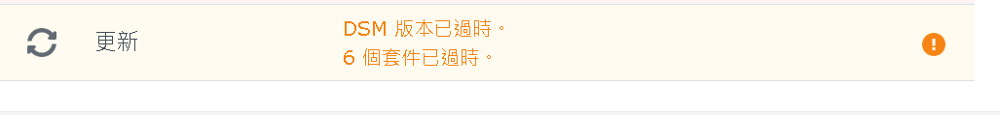
<br/>
<br/>確認後我的 NAS 是低於 **7.2-64570-4** 的 **7.1-42661 Update 1** 那麼就有必要更新 
<br/>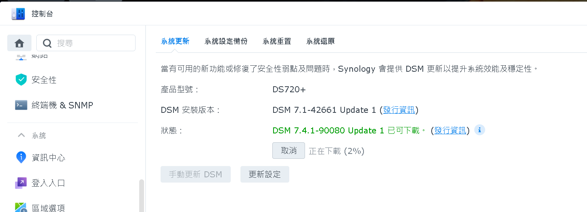
<br/><br/>

<h2>Step 2：DSM 版本防護 - 確認影響</h2>
安裝好更新檔案後，開始更新前會提示影響的範圍，以我的 NAS 為例， Node.js 與 Docker 會不支援，如果不能接受
<br/>則要選擇手動更新的方式，找出適合自己的版本，這邊選擇 **更新到最新**
<br/>※這裡的 Docker 不支援，實際上還是支援的，是轉移到 Container Manager
<br/>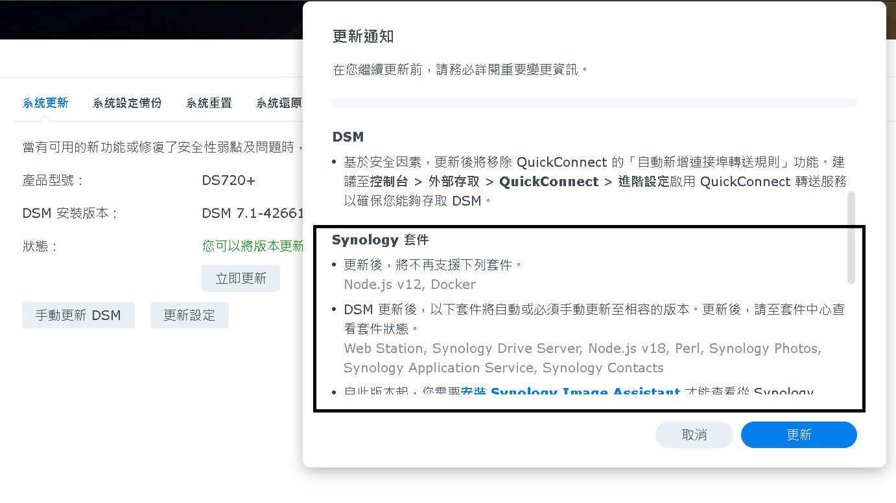
<br/>
<br/>並且有些過時的套件會要求強制刪除，這就需要自己到套件中心移除 -> 然後再繼續更新
<br/>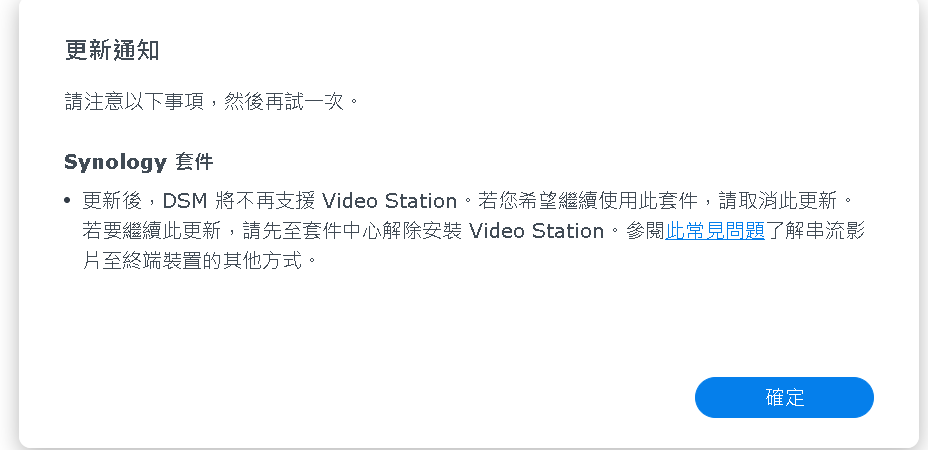
<br/><br/>

<h2>Step 3：補充 DSM 更新後的影響</h2>
在順利更新後
<br/>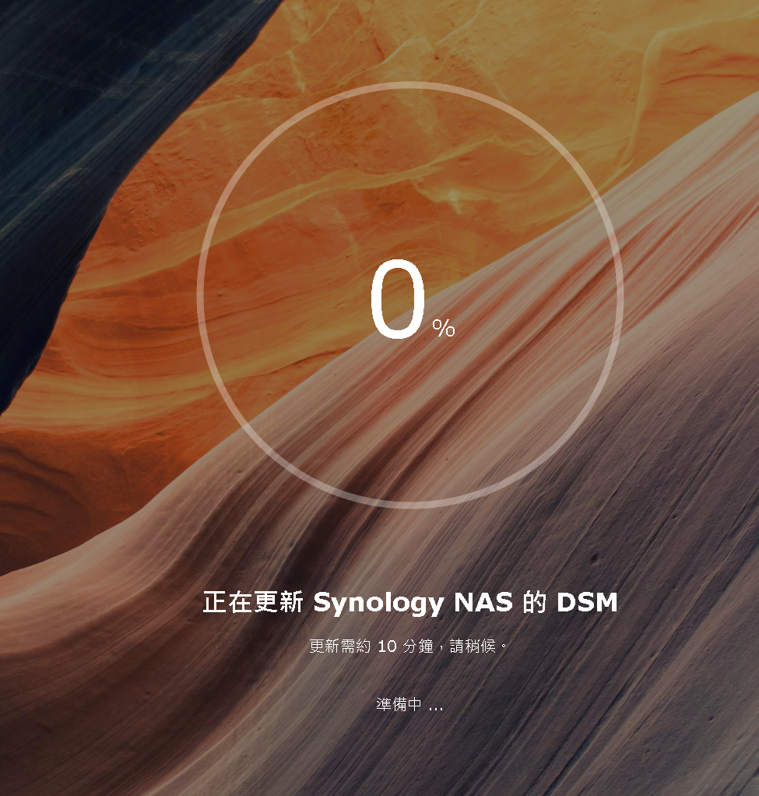
<br/>
<br/>Docker 的 Portainer 與 Bookstack 仍是正常可運行，表示 DSM 順利更新也成功轉移到 Container Manager
<br/>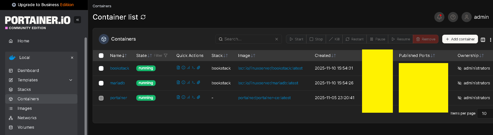
<br/><br/>


<h2>Step 4：PHP 防護 - 檢查套件版本</h2>
要檢查 PHP 版本，最快的方式是到 NAS 的套件中心對應軟體
<br/>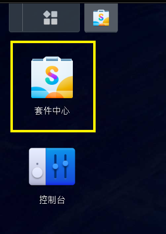
<br/>
<br/>這次的影響套件包括：**Web Station、WordPress、phpMyAdmin...** 因為我有安裝 WebStaion 因此檢查此軟體
<br/>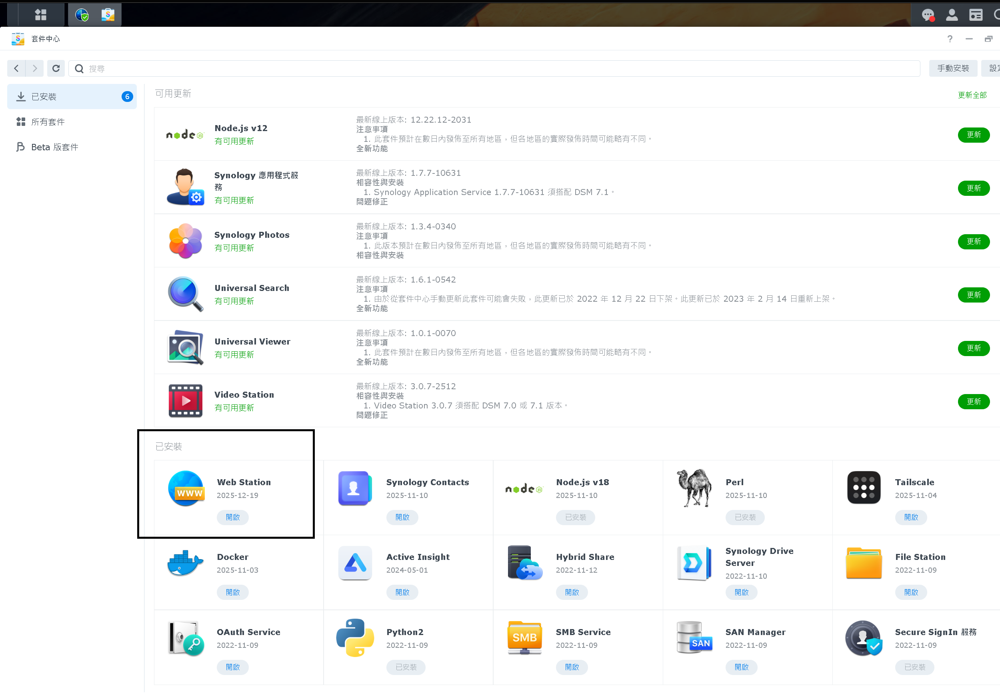
<br/><br/>

<h2>Step 5：PHP 防護 - 安裝或移除套件 PHP 版本</h2>
以我的 Web Staion 為例(我用 Nginx 代碼，因此 PHP 未使用)，PHP 對應的版本沒有達到要求，則可以選擇管理 -> 進行對應的版本升級  
<br/>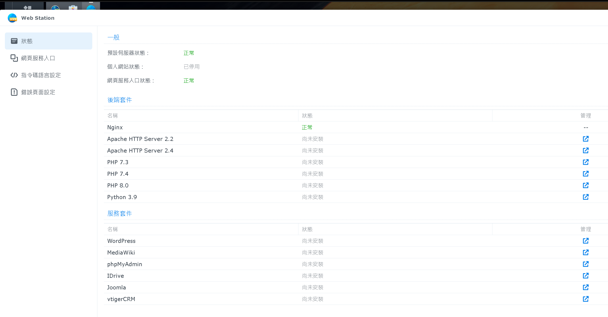


<h2>Step 6：結語補充</h2>
回到一開始的HKEPC 報導：<a href="https://www.hkepc.com/27124">Synology NAS 驚爆大規模勒索攻擊</a>
<br/>裡面最後的做法有提到強制關閉 NAS 網路，但完整看完整篇應該可以理解：文章的目的是 **警告已受攻擊的 NAS 使用者**。
<br/>對於尚未被攻擊的讀者，應該可以採取更合適自己的防禦方式，因為消費者買了 NAS 的用途：

``` Markdown
安全地隨時存取自己的資料，而不是為了避免攻擊，把買來的 NAS 變成只能在家裡使用的硬碟。
```

<br/>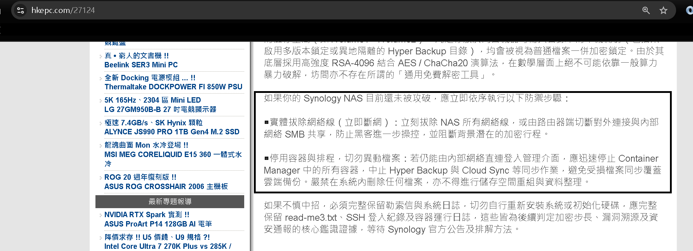
<br/><br/>