<div class="summary">
<br/>應用所需：1. Windows 10／11、macOS 或 Linux 電腦
<br/>&emsp;&emsp;&emsp;&emsp;&emsp;2. 已安裝支援 Speech to Text 的新版 Shotcut (本篇 Version 26.8.1)
<br/>&emsp;&emsp;&emsp;&emsp;&emsp;3. 一段含有人聲的影片或音訊
<br/>解決問題：1. 不依賴付費雲端服務，直接使用 Shotcut 內建 AI 產生時間軸字幕
<br/>&emsp;&emsp;&emsp;&emsp;&emsp;2. 字幕已經產生，卻沒有出現在預覽畫面或輸出影片
<br/>&emsp;&emsp;&emsp;&emsp;&emsp;3. 正確處理單語、雙語與多國字幕軌
<br/>Shotcut 官方網站：<a href="https://shotcut.org/">Shotcut</a>
<br/>官方字幕面板說明：<a href="https://forum.shotcut.org/t/view-subtitles/45312">View &gt; Subtitles</a>
<br/>官方 AI 字幕說明：<a href="https://shotcut.org/stockmedia/Shotcut%20User%20Guide.pdf">Shotcut User Guide - Speech to Text</a>
<br/>相關參考：<a href="https://gotoa1234.github.io/2026/11/14/1.html">0010. 用 AI 重現聖女貞德的一生！整合 ComfyUI、Wan...</a>(聲音檔、影片剪輯的素材來源此篇文章)
<br/>重要觀念：字幕面板中的文字只是「字幕資料」，若要讓字幕固定出現在影片畫面，仍需使用 Subtitle Burn In 或 Generate Text on Timeline
<br/>本篇分為 4 大部分。
<br/>第一部分：Shotcut 軟體快速介紹
<br/>第二部分：Shotcut 解決 - 生成字幕 &amp; 內建 AI
<br/>第三部分：Shotcut 解決 - 字幕無法出現
<br/>第四部分：Shotcut 解決 - 多國字幕無法出現
</div>

<div class="title">
    <br/><hr class="titleinner">
	<span></span>
	<hr class="titleinner"><br/>
</div>


<br/><br/>
<h1>第一部分：Shotcut 軟體快速介紹</h1>

<h2>Step 1：Shotcut 是什麼？</h2>
<a href="https://shotcut.org/">Shotcut</a> 是一套免費、開源、跨平台的影片剪輯軟體，可在 Windows、macOS 與 Linux 使用。
<br/>它支援時間軸剪輯、濾鏡、轉場、關鍵影格、代理檔、字幕與多種影音格式，適合用來製作教學影片、YouTube 長片與直式 Shorts。

``` Markdown
Shotcut 的定位：
- 免費且開源，不需要訂閱
- 可處理一般剪輯、字幕、音訊與轉場
- 內建 Speech to Text，可用 AI 將人聲轉成字幕
- 可匯出 SRT，也能把字幕直接燒錄進影片
```

<br/>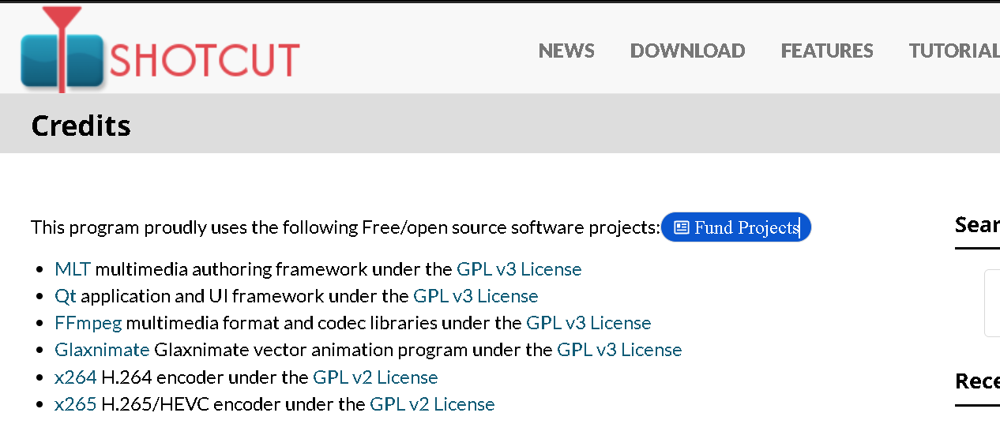
<br/><br/>


<h2>Step 2：Shotcut 的字幕有哪幾種形式？</h2>
第一次接觸 Shotcut 字幕時，最容易混淆的是：**字幕面板中看得到文字，不代表影片畫面一定會顯示字幕。**

{:class="table table-bordered"}
| 字幕形式 | 特性 | 適合用途 |
| :--- | :--- | :--- |
| 字幕軌／SRT | 保存文字與時間碼，可另外開關 | YouTube 字幕軌、播放器切換語言 |
| 嵌入式字幕 | 字幕包在 MP4、MOV 或 MKV 等容器中 | 支援字幕切換的播放器 |
| Subtitle Burn In | 字幕永久成為影片畫面的一部分 | YouTube Shorts、社群影片、避免字幕遺失 |
| Generate Text on Timeline | 把每段字幕轉成時間軸上的文字片段 | 逐句做不同字型、顏色或動畫 |

<br/>如果影片主要發布在 YouTube Shorts、Instagram Reels 或其他直式平台，最穩定的方式通常是 **Subtitle Burn In（字幕壓製）**。
<br/>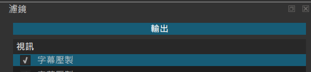
<br/><br/>


<h2>Step 3：開始前準備</h2>
建議先完成以下準備，再開始產生 AI 字幕：

``` Markdown
1. 從 Shotcut 官方網站下載目前的穩定版本
2. 建立新專案並設定正確解析度與幀率
3. 將影片拖曳到 Timeline
4. 確認影片真的有人聲，而且音軌沒有靜音
5. 優先使用人聲清楚、背景音較小的素材
6. 保留原始專案與影片備份
```

<br/>Speech to Text 在較新的版本也陸續增加模型下載器與 GPU 支援，因此舊版找不到此功能時，應先更新 Shotcut。
<br/>※操作介面可能隨版本更新略有不同，本文以 Version 26.8.1 介面的功能名稱為主。
<br/>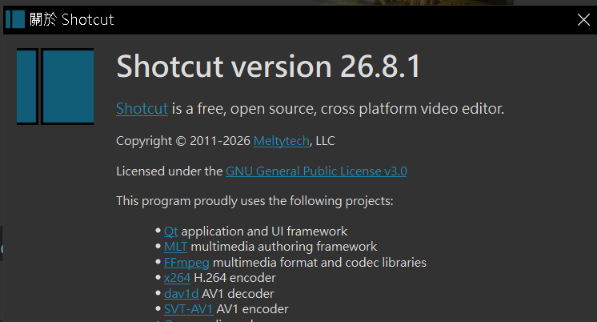
<br/><br/>


<br/><br/>
<h1>第二部分：Shotcut 解決 - 生成字幕 &amp; 內建 AI</h1>

<h2>Step 1：說明 - 內建 AI 使用的是 Whisper.cpp</h2>
Shotcut 的 Speech to Text 並不是 Shotcut 自行訓練的 AI，而是整合 <a href="https://github.com/ggml-org/whisper.cpp">whisper.cpp</a>，使用 Whisper 相容模型將聲音轉成文字與時間碼。

``` Markdown
影片／音訊
    ↓ 擷取專案中的聲音
whisper.cpp + GGML 模型
    ↓ 語音辨識與時間切割
Shotcut Subtitle Track
    ↓ 校對與調整
SRT／嵌入字幕／燒錄字幕
```

<br/>模型下載完成後，辨識工作主要在本機執行，不需要額外申請 API Key
<br/>※實際速度取決於影片長度、模型大小、CPU／GPU 與記憶體。
<br/><br/>


<h2>Step 2：AI 生成字幕 - 選擇 AI 模型準備工作</h2>
打開 Shotcut 軟體 -> 檢視 -> 字幕 (Ctrl + Shift + 9) 
<br/>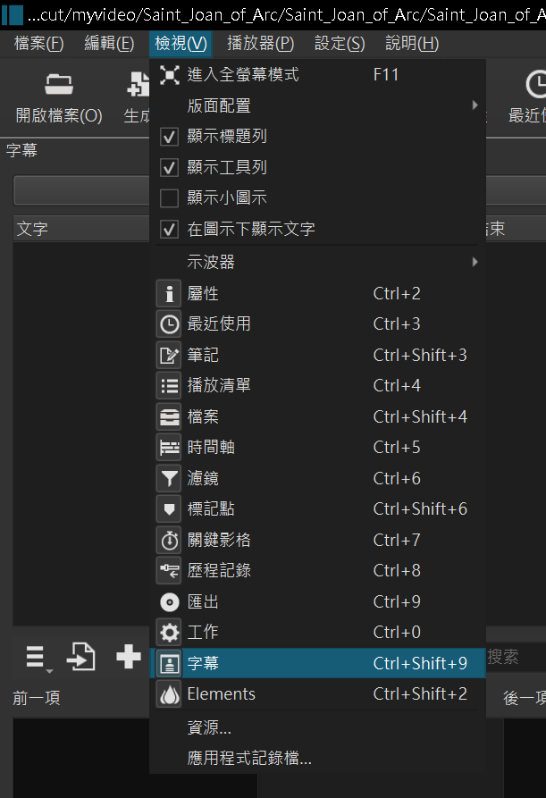
<br/>
<br/>建立字幕
<br/>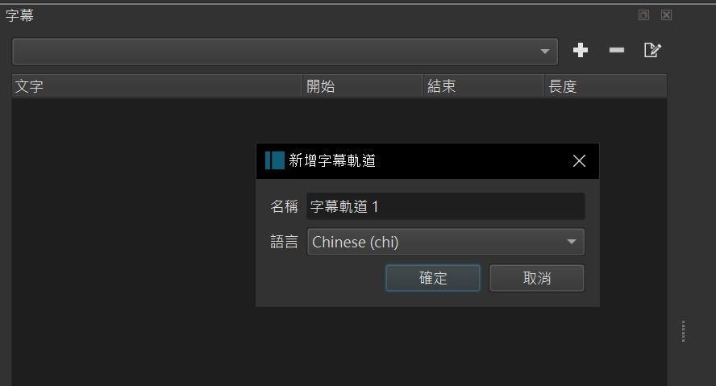
<br/>
<br/>選擇 **偵測語音並將其轉錄至新的字幕軌道**
<br/>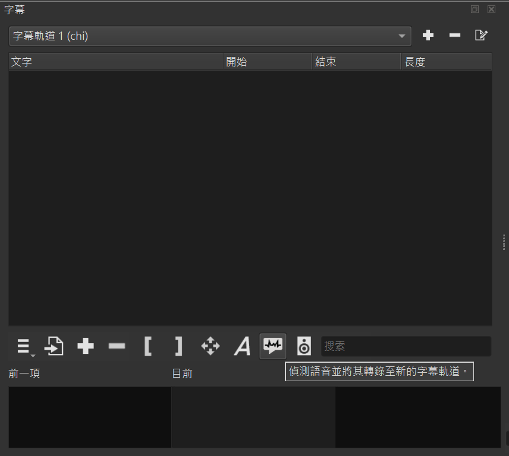
<br/>
<br/>會出現 **語音轉換文字** -> 將 GPU 打勾 -> 將語音來源軌道來源打勾 -> 選擇 **設定** 展開模型
<br/>※語言選項要跟當前影片的語音相同語系
<br/>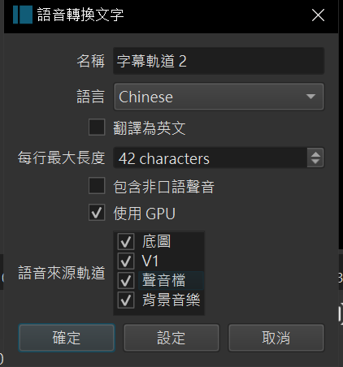
<br/><br/>


<h2>Step 3：AI 生成字幕 - 選擇 AI 模型</h2>
選擇 **設定** 展開模型後會出現下方可以下載的模型，這邊範例選擇的 **基礎多語言量化 5_** 小型模型，安裝完成後，對應的 Whisper.cpp 與 GGML 模型會自動對應
<br/>※某些版本的BUG會需要手動設定路徑
<br/>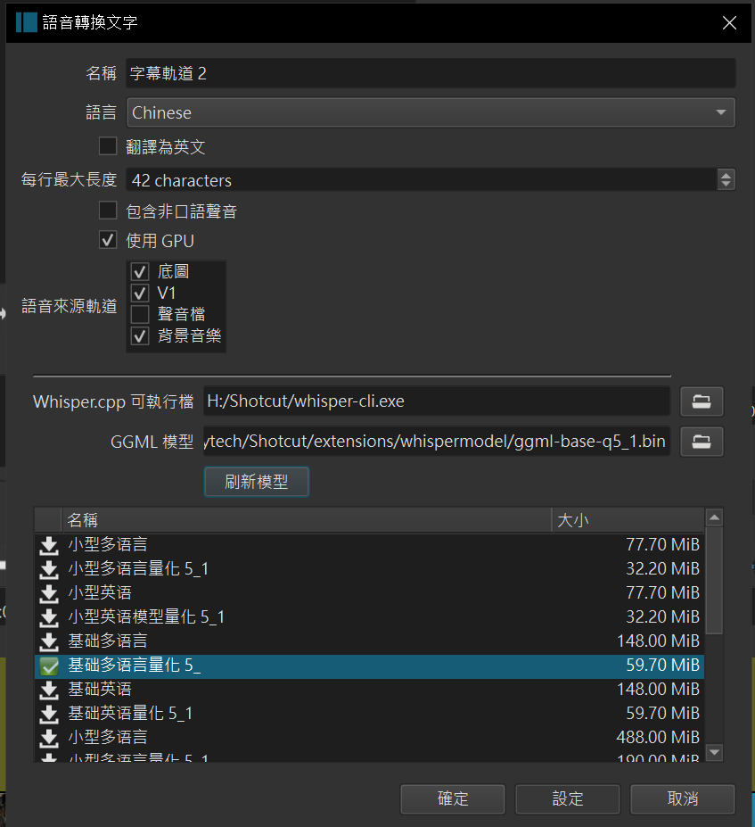
<br/>
<br/>模型越大，通常辨識能力越好，但處理時間與記憶體需求也會提高，以下整理提供參考：

{:class="table table-bordered"}
| 模型方向 | 速度 | 資源需求 | 建議用途 |
| :--- | :---: | :---: | :--- |
| Tiny／Base | 快 | 低 | 先測試流程、聲音非常清楚的短片 |
| Small | 中等 | 中等 | 一般中文教學與 YouTube 影片，可作為起點 |
| Medium 以上 | 較慢 | 高 | 口音、專有名詞或較複雜的錄音 |

<br/><br/>


<h2>Step 4：使用 Speech to Text 自動產生字幕</h2>
確認後按下 OK，Shotcut 會在 Jobs 面板建立工作。一般會先匯出分析用音訊，再進行語音轉文字。
<br/>請等待所有工作完成，依照本機 GPU 算力會決定運算速度
<br/>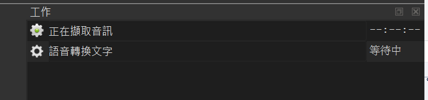
<br/>
<br/>完成後字幕就會自動生成
<br/>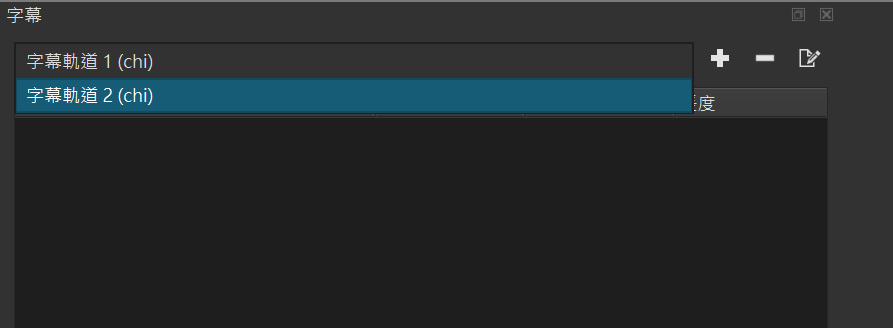
<br/>
<br/>檢視下方的 **輸出** 軌道，可以看到會依照前面設定的 42 字節，來做切割，生成語音對應影片
<br/>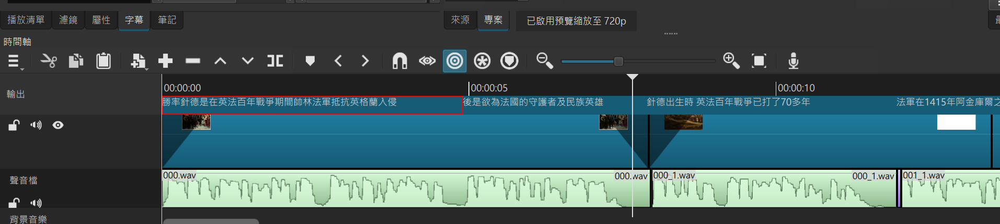
<br/><br/>


<h2>Step 5：校對 AI 生成結果</h2>
工作完成後，結果會加入 Subtitles 面板成為新的 Subtitle Track。我們仍需要進行校正工作：
<br/>如果語音越是字正腔圓，那麼字幕就會很精準，但通常影片的語音要有人的感覺，所有某些地方仍需要手動校正(AI判斷不出來 EX: 好的 / 好地)

``` Markdown
- 人名、地名、品牌與技術名詞是否正確
- 中文標點符號是否自然
- 每段字幕是否過長
- 字幕開始時間是否太早或太晚
- 長時間停頓是否被辨識成不存在的句子
- 背景音樂或歌詞是否被誤判成旁白
```

<br/>
<br/>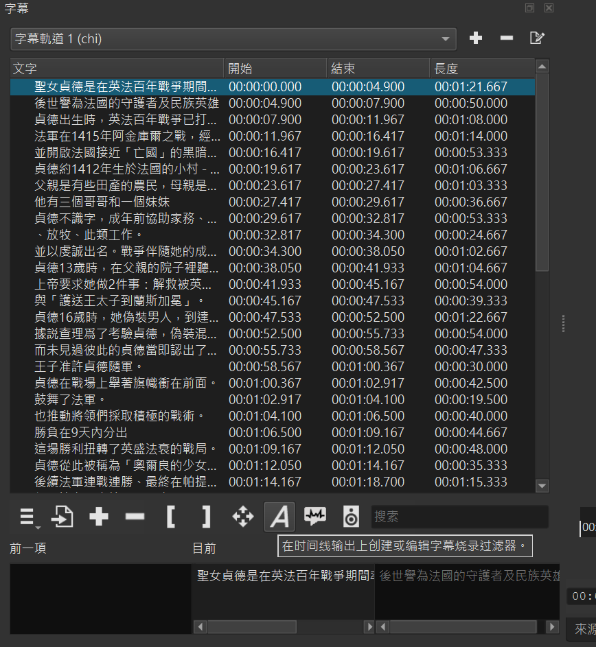
<br/><br/>


<br/><br/>
<h1>第三部分：Shotcut 解決 - 字幕無法出現</h1>

<h2>Step 1：先判斷是哪一種「沒有字幕」</h2>
字幕無法出現不一定是 Bug，先依畫面狀況判斷問題位於哪個階段：

{:class="table table-bordered"}
| 狀況 | 可能原因 | 優先處理方式 |
| :--- | :--- | :--- |
| Subtitles 面板完全沒有文字 | AI 工作尚未完成、工作失敗、選錯音軌 | 檢查 Jobs 與 Speech to Text 設定 |
| 面板有文字，預覽畫面沒有 | 尚未加入 Subtitle Burn In | 對 Timeline Output 加入燒錄字幕濾鏡 |
| 預覽有字幕，匯出後沒有 | 輸出範圍、濾鏡或字幕軌選擇錯誤 | 檢查 Output 濾鏡與匯出成品 |
| 播放器中字幕需要手動開啟 | 使用的是 Soft Subtitle | 在播放器開啟字幕，或改用 Burn In |
| 同一句字幕出現兩次或三次 | 同時使用多種字幕呈現方式 | 只保留一種畫面渲染方式 |

<br/><br/>


<h2>Step 2：字幕已產生，但預覽畫面看不到</h2>
這是最常見的情況。Subtitles 面板負責保存文字與時間，預設不等同於將文字繪製在影片畫面上。
<br/>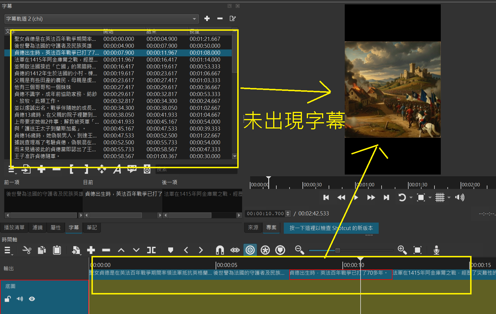
<br/><br/>
<br/>
<br/>若要固定顯示字幕，要依序：
<br/>選擇字幕 -> 濾鏡 -> 點擊 + (新增濾鏡) -> 選擇 Subtitle Burn In(字幕壓製) -> 打勾 (表示啟用)
<br/>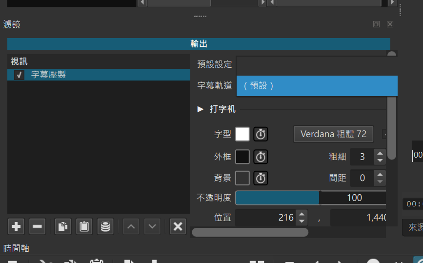
<br/>
<br/>最終字幕就會出現在畫面上：
<br/>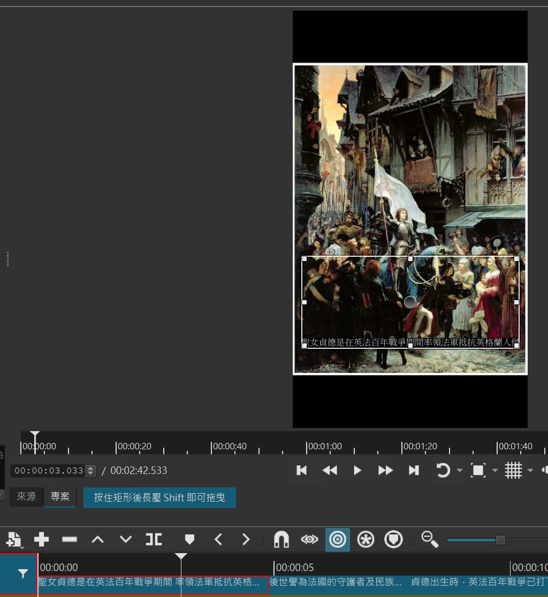
<br/><br/>


<h2>Step 3：解決無法匯入字幕的問題</h2>
通常為了快速編輯，或者請 AI 編輯字幕檔案，最快的方式是先匯出 .srt 字幕檔案，再委派處理
<br/>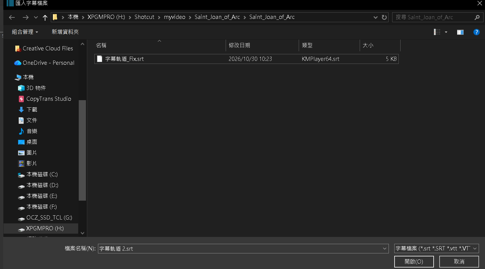
<br/>
<br/>但匯入時有可能出現 **ffmpeg not found. Cannot import subtitles.**
<br/>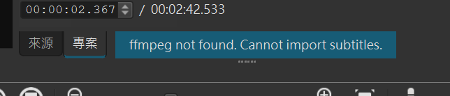
<br/>
<br/>解法就是將 **ffmpeg** 安裝到 shotcut 的目錄下，如圖，雖然目前有 **ffmpeg.exe**：
<br/>※在 shotcut 版本： 26.8.1 仍有此 BUG，除了安裝在 shotcut 目錄下，其餘目錄會無視
<br/>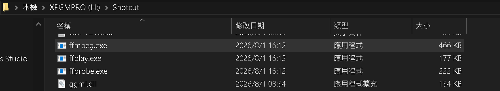
<br/>
<br/>因為特定版本的 BUG ，因此要將 **ffmpeg.exe** 改名成 **ffmpeg**：
<br/>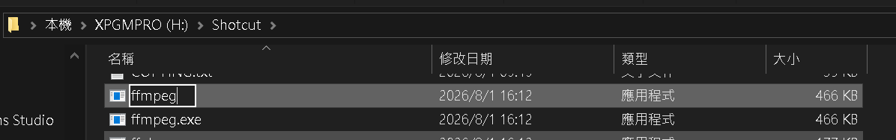
<br/>
<br/>最終重啟 shotcut 程式可恢復正常，匯入時出現 **Imported 61 subtitle item(s)** 表示成功
<br/>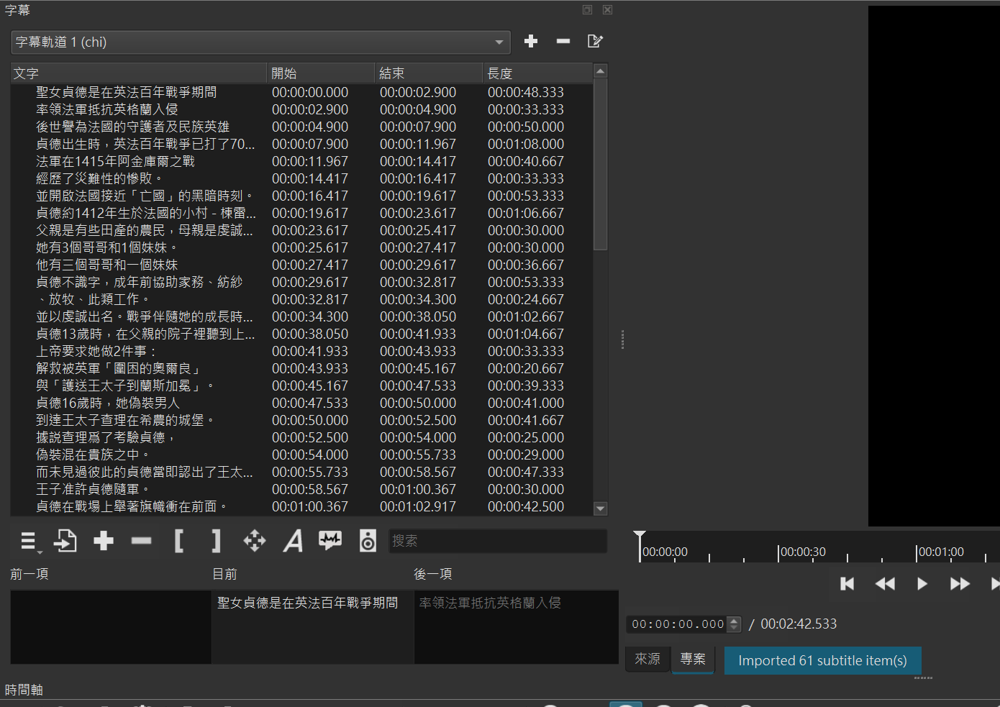
<br/><br/>


<br/><br/>
<h1>第四部分：Shotcut 解決 - 多國字幕無法出現</h1>

<h2>Step 1：狀況1 - 字型可能有問題</h2>
如果 Subtitles 面板內的文字正確，但影片畫面顯示 `□`、空白或缺字，通常不是 AI 辨識失敗，而是目前字型沒有該語言的字形。

{:class="table table-bordered"}
| 語言 | 可優先測試的字型方向 |
| :--- | :--- |
| 繁體中文 | Noto Sans CJK TC、Microsoft JhengHei |
| 簡體中文 | Noto Sans CJK SC、Microsoft YaHei |
| 日文 | Noto Sans CJK JP、Yu Gothic |
| 韓文 | Noto Sans CJK KR、Malgun Gothic |
| 多語混合 | Noto Sans 系列，並逐段檢查缺字 |

<br/>這種情況下，需要安裝新字型，並重新開啟 Shotcut，再回到 Subtitle Burn In 重新選擇字型。
<br/>※若同一段字幕同時包含中文、日文、韓文與特殊符號，仍可能需要更換字型或拆分成不同文字軌。
<br/><br/>


<h2>Step 2：狀況2 - 匯入 SRT 後無法生效</h2>
此狀況是當以下操作 : 新增字幕 -> 添加了字幕軌道
<br/>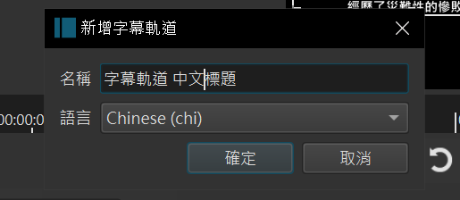
<br/>
<br/>然後匯入了另一個 .srt 檔案，或者生成的字幕
<br/>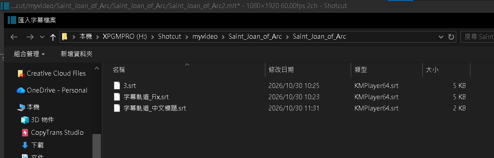
<br/>
<br/>匯入完成後，並且 **打勾濾鏡的 Subtitle Burn In(字幕壓製)**
<br/>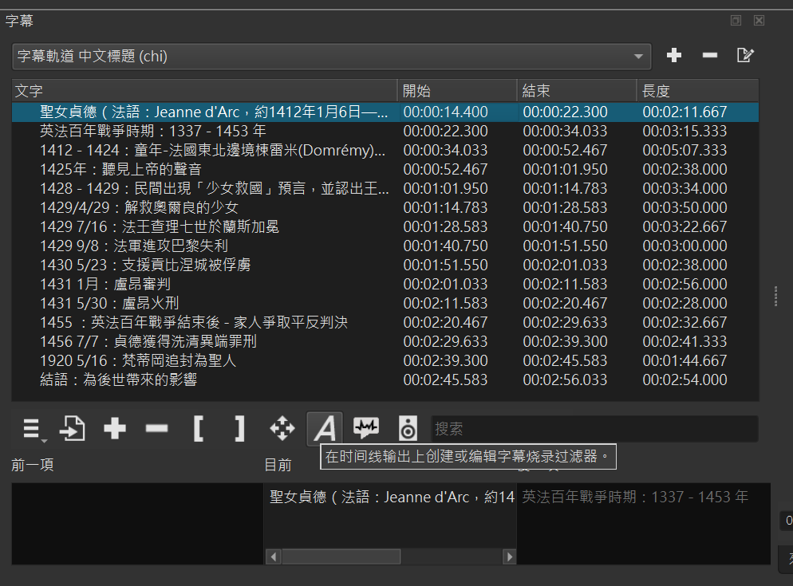
<br/>
<br/>但畫面上無論怎麼調整都無法出現該字幕
<br/>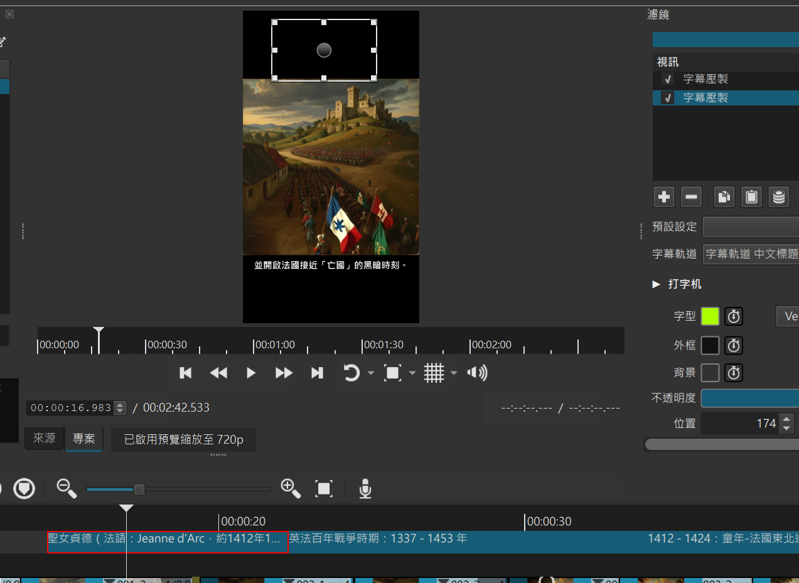
<br/><br/>


<h2>Step 3：狀況2 - 匯入 SRT 後無法生效解法</h2>
實際上只要關閉 shotcut 然後在啟動，就會正常出現，這是程序對代碼邏輯 BUG 問題
<br/>※簡單說：在接近 shotcut 版本 - 26.8.1 只要 **匯入字幕時** 就必須重啟 shotcut 應用程式
<br/>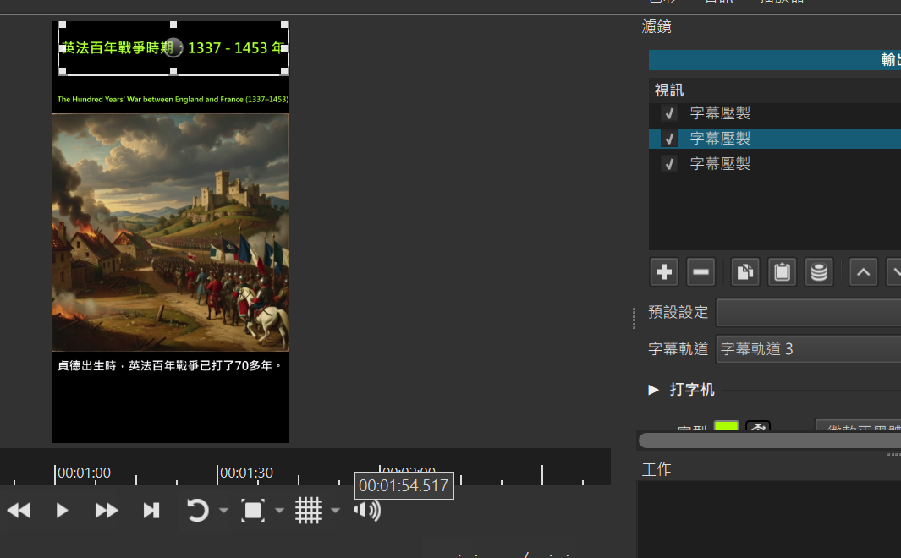
<br/><br/>


