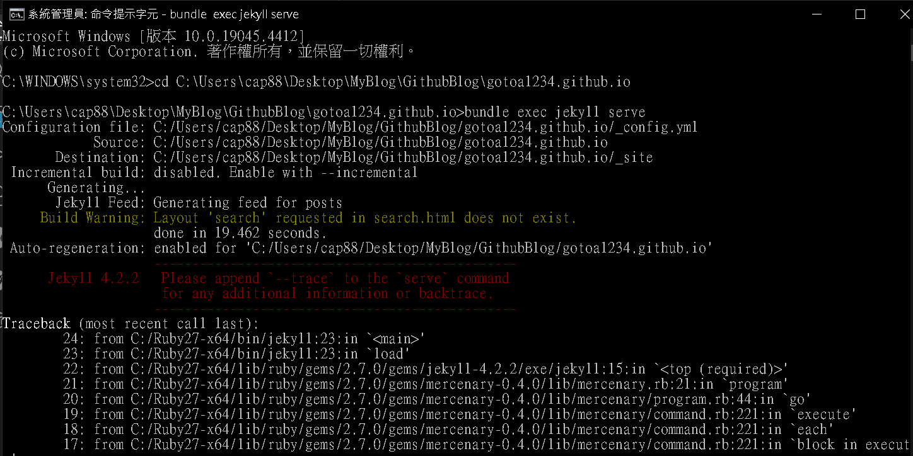
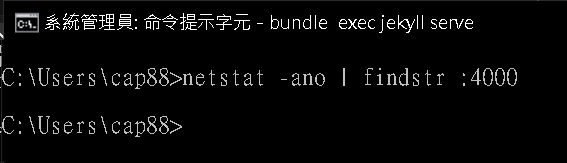
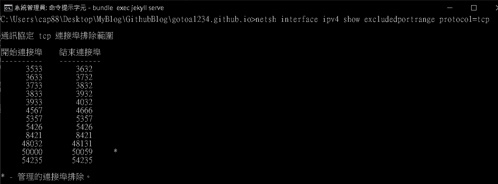
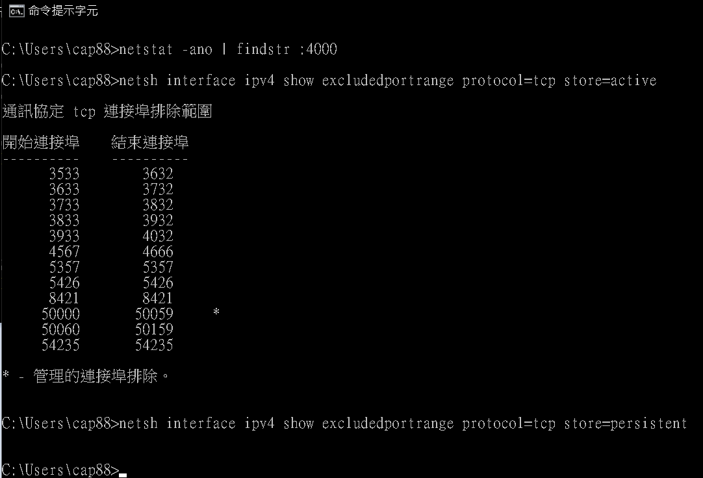
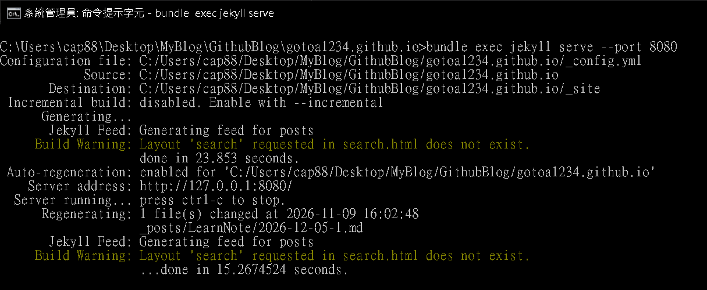
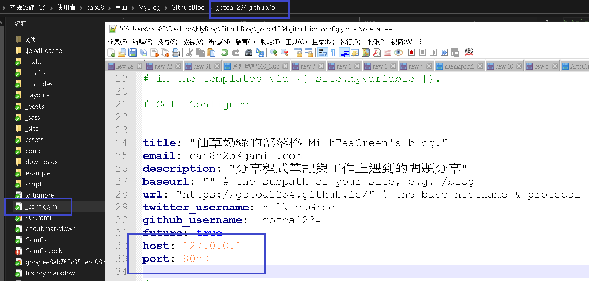

<div class="summary">
<br/>應用所需：1. Windows 10 以上作業系統
<br/>&emsp;&emsp;&emsp;&emsp;&emsp;2. 已安裝 Ruby、Jekyll，並可正常產生網站內容
<br/>解決問題：1. Jekyll 執行 serve 時出現 Permission denied - bind(2) for 127.0.0.1:4000 (Errno::EACCES)
<br/>&emsp;&emsp;&emsp;&emsp;&emsp;2. netstat 查不到占用 Port 的程式，仍然無法啟動本機 Web Server
<br/>基本介紹：本篇分為四大部分。
<br/>第一部分：問題描述
<br/>第二部分：排查 Port 是否被程式占用
<br/>第三部分：確認 Windows Port 排除範圍
<br/>第四部分：解決方案與結論
</div>

<div class="title">
    <br/><hr class="titleinner">
  <span></span>
  <hr class="titleinner"><br/>
</div>

<br/><br/>
<h1>第一部分：問題描述</h1>

<h2>Step 1：Jekyll 建置完成，但本機伺服器啟動失敗</h2>
在 Windows 執行 Jekyll 專案時，使用預設指令啟動本機網站：

``` batch
bundle exec jekyll serve
```

<br/>從執行結果可觀察到 Jekyll 已完成網站內容產生，但進入啟動 Web Server 的階段後失敗，最後出現以下關鍵錯誤：

``` Markdown
Permission denied - bind(2) for 127.0.0.1:4000 (Errno::EACCES)
```

<br/>其中 `127.0.0.1:4000` 是 Jekyll 預設監聽的本機位址與 Port
<br/>`bind` 失敗則表示 Ruby 無法將 Web Server 綁定到這個位址。
<br/>這次問題並不是 Jekyll 無法產生網站，也與下方的 Layout 警告無直接關係：
<br/>

``` Markdown
Build Warning: Layout 'search' requested in search.html does not exist.
```

<br/>真正需要調查的是：**為什麼 Windows 拒絕應用程式使用 Port 4000？**
<br/>
<br/><br/>


<br/><br/>
<h1>第二部分：排查 Port 是否被程式占用</h1>

<h2>Step 1：使用 netstat 查詢 Port 4000</h2>
遇到 Port 無法綁定時，第一個要確認的是是否已有其他程式監聽相同 Port。
<br/>開啟 Windows Command Line，輸入：

``` batch
netstat -ano | findstr :4000
```

<br/>如果有查詢結果，可以依最後一欄的 PID 找出占用 Port 的程式
<br/>但這次執行後沒有任何結果，表示當下沒有程式透過 `netstat` 顯示正在監聽 Port 4000。
<br/>
<br/><br/>

<h2>Step 2：沒有程式占用，不代表 Windows 一定允許使用</h2>
`netstat` 主要顯示目前的網路連線與監聽狀態；如果 Port 被 Windows 列入排除範圍，可能沒有任何程式正在監聽，應用程式仍無法綁定。
<br/>因此，遇到 `Errno::EACCES` 且 `netstat` 查不到占用程式時，下一步 **應檢查 Windows 的 Excluded Port Range（連接埠排除範圍）。**
<br/><br/>


<br/><br/>
<h1>第三部分：確認 Windows Port 排除範圍</h1>

<h2>Step 1：使用 netsh 查詢 TCP Port 排除範圍</h2>
在 Windows Command Line 輸入：

``` batch
netsh interface ipv4 show excludedportrange protocol=tcp
```

<br/>這次查詢結果中包含以下範圍：

``` Markdown
開始連接埠    結束連接埠
----------    ----------
      3933        4032
```

<br/>Jekyll 預設使用的 Port 4000 位於 `3933～4032` 之間，因此受到排除範圍影響。
<br/>進一步測試 Port 4001 時，也出現相同的 `Errno::EACCES`，因為 Port 4001 同樣落在這段範圍內。
<br/>
<br/><br/>

<h2>Step 2：確認問題與尚未確認的來源</h2>
目前能由實際輸出確認的因果關係如下：

{:class="table table-bordered"}
| 檢查項目 | 結果 |
| Port 4000 是否被程式監聽 | `netstat` 未查到 |
| Port 4000 是否在排除範圍 | 是，位於 3933～4032 |
| Port 4001 是否可使用 | 否，同樣位於 3933～4032 |
| 改用排除範圍外的 Port | 可正常啟動 |

<br/>Windows 的虛擬網路功能可能一次管理或保留一段 Port。HNS（Host Network Service）、WinNAT、WSL2、Hyper-V 或容器功能都可能與這類配置有關。
<br/>但僅憑排除範圍清單，**無法判定是哪一個元件建立了 3933～4032**
<br/>所以本文只將它們列為可能的調查方向，不直接認定其中任何一項就是本次根因。
<br/><br/>

<h2>Step 3：如需進一步調查，可比較 Active 與 Persistent 設定</h2>
若希望繼續釐清排除範圍的性質，可分別查詢目前生效與持久保存的設定：

``` batch
netsh interface ipv4 show excludedportrange protocol=tcp store=active
netsh interface ipv4 show excludedportrange protocol=tcp store=persistent
```

<br/>若某段範圍只出現在 Active 清單，可能是系統執行期間動態配置；但這仍不能單獨證明建立者是 HNS、WSL2 或 Hyper-V。
<br/>若目前只需要讓 Jekyll 正常執行，沒有必要先修改 Windows 的底層網路設定。
<br/>
<br/><br/>


<br/><br/>
<h1>第四部分：解決方案與結論</h1>

<h2>Step 1：改用 Port 8080 啟動 Jekyll</h2>
確認 Port 8080 沒有被其他程式占用，也不在目前列出的排除範圍後，執行：

``` batch
bundle exec jekyll serve --port 8080
```

<br/>Jekyll 即可正常啟動，接著使用瀏覽器開啟：

``` Markdown
http://127.0.0.1:8080/
```

<br/>
<br/><br/>


<h2>Step 2：需要固定使用 8080 時，修改 _config.yml</h2>
如果不希望每次啟動都輸入 `--port 8080`，可以在專案的 `_config.yml` 加入：

``` yaml
host: 127.0.0.1
port: 8080
```

<br/>之後直接執行：

``` batch
bundle exec jekyll serve
```

<br/>如果設定檔已經存在 `host` 或 `port`，應修改原有欄位，不要重複加入相同設定。
<br/>
<br/><br/>


<h2>Step 3：不要急著刪除 Windows 排除範圍</h2>
直接刪除 `3933～4032` 的排除範圍，可能影響建立它的系統或虛擬網路功能，而且重新啟動後也可能再次出現。
<br/>在尚未確認建立來源前，改用不衝突的 Port 是風險較低且足以解決 Jekyll 開發需求的方式。
<br/><br/>


<h2>Step 4：總結</h2>
這次問題的關鍵不是 Jekyll、Ruby 或網站內容建置失敗，而是 Windows 不允許應用程式綁定 Port 4000。
<br/>排查流程可以整理為：

{:class="table table-bordered"}
| 步驟 | 檢查方式 | 判斷重點 |
| 1. 確認錯誤階段 | 查看 Jekyll Log | 網站已產生，失敗在 Web Server bind |
| 2. 檢查程式占用 | `netstat -ano \| findstr :4000` | 沒有輸出不代表 Port 一定可用 |
| 3. 檢查系統排除 | `netsh interface ipv4 show excludedportrange protocol=tcp` | 4000 位於 3933～4032 |
| 4. 改用其他 Port | `bundle exec jekyll serve --port 8080` | Jekyll 恢復正常 |

<br/>最後值得記錄的觀念是：
<br/>**沒有程式占用 Port，不代表 Windows 一定允許應用程式使用這個 Port。**
<br/>未來遇到 Node.js、Python、Ruby、Docker 或其他本機 Web Server 的 bind 權限錯誤時，也可以沿用相同的排查方式。
<br/><br/>


