<div class="summary">
<br/>應用所需：1. Azure SQL Database Standard S0（DTU）與可登入的資料庫帳號
<br/>&emsp;&emsp;&emsp;&emsp;&emsp;2. Synology DS720+、Container Manager（Docker）
<br/>&emsp;&emsp;&emsp;&emsp;&emsp;3. SqlPackage、HeidiSQL 或其他 SQL Server 用戶端工具
<br/>解決問題：1. 將 Azure SQL Database 透過 BACPAC 搬遷到 NAS SQL Server 2019 Express
<br/>&emsp;&emsp;&emsp;&emsp;&emsp;2. 避開 SQL Server 版本、Docker Volume、Btrfs 與 TLS 憑證問題
<br/>&emsp;&emsp;&emsp;&emsp;&emsp;3. 完成應用程式切換並刪除 Azure SQL Database 停止計費
<br/>基本介紹：本篇分為六大部分。
<br/>第一部分：遷移目的與環境
<br/>第二部分：SQL Server 2025、2022、2019 版本踩坑
<br/>第三部分：建立 NAS 上的 Sql Server 2019 Docker Container
<br/>第四部分：SqlPackage 匯出與匯入 BACPAC
<br/>第五部分：HeidiSQL 連線驗證資料
<br/>第六部分：正式切換、Azure 停費與注意事項
</div>

<div class="title">
    <br/><hr class="titleinner">
  <span></span>
  <hr class="titleinner"><br/>
</div>

<br/><br/>
<h1>第一部分：遷移目的與環境</h1>

<h2>Step 1：為什麼將 Azure SQL 搬到 NAS？</h2>
本次來源資料庫是 Azure SQL Database Standard S0，採 DTU 計費模式，規格為 10 DTU、最大配置儲存體 250GB **實際資料庫約 3GB。**

``` Markdown
由於服務流量與資料量不高，家中又已有長時間開機的 Synology DS720+ ，
因此決定將資料庫移到 NAS，降低持續使用雲端資料庫的固定成本。

這個選擇不代表 NAS 一定比 Azure SQL 好，而是針對小型個人服務做取捨。
搬到地端後，Docker、硬體、網路及資料庫維護都要自行負責。
```

<br/>
<br/>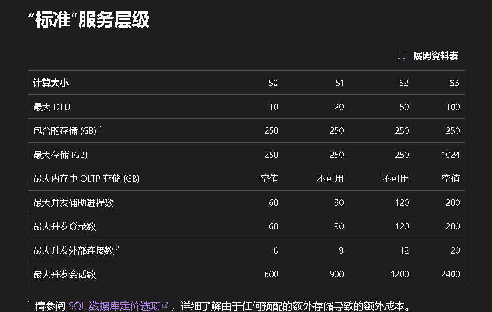
<br/><br/>

<h2>Step 2：本次遷移環境</h2>

{:class="table table-bordered"}
| 項目 | 使用環境 |
| 來源 | Azure SQL Database Standard S0 |
| 目標設備 | Synology DS720+，Intel x86-64 CPU |
| 容器平台 | Synology Container Manager／Docker Compose |
| 目標資料庫 | SQL Server 2019 Express Linux Container |
| 儲存空間 | Synology Btrfs Volume |
| Port | NAS `14334` 對應容器 `1433` |
| 遷移工具 | SqlPackage、BACPAC |

<br/>整體資料流如下：

<br/>BACPAC 包含資料庫結構與資料，很適合這類 Azure SQL Database 搬遷到 SQL Server 的情境。
<br/>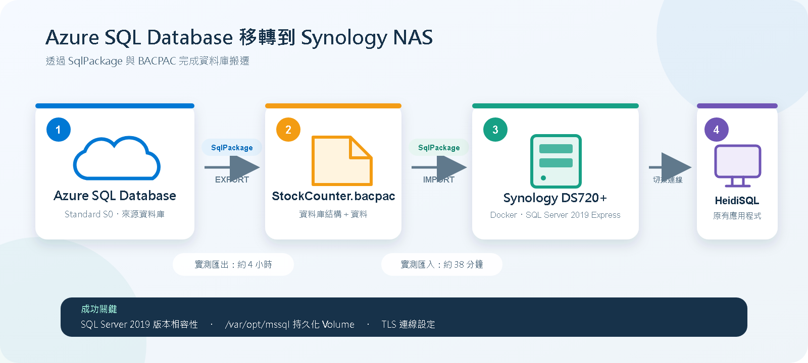
<br/><br/>


<br/><br/>
<h1>第二部分：SQL Server 2025、2022、2019 版本踩坑</h1>

<h2>Step 1：先後測試三個版本</h2>
原本希望直接使用新版 SQL Server，因此先後測試 2025、2022，最後才改用 2019。

{:class="table table-bordered"}
| SQL Server 版本 | 本次 DS720+ 測試結果 |
| 2025 | 容器無法穩定完成初始化 |
| 2022 | 同樣出現啟動或初始化問題 |
| 2019 | 成功啟動、建立資料庫並完成 BACPAC 匯入 |

<br/>這只代表本次 DS720+、DSM、Docker 與儲存環境的實測結果，不代表 SQL Server 2022、2025 在所有 Synology NAS 上都不能執行。
<br/>如果新版容器不斷重新啟動，與其一直更換參數，不如先用較成熟的 2019 Image 交叉測試，快速判斷問題是否與版本有關。
<br/>※以下以 MSSQL 2025 的 Express ~ Enterprise 做比較差異
<br/>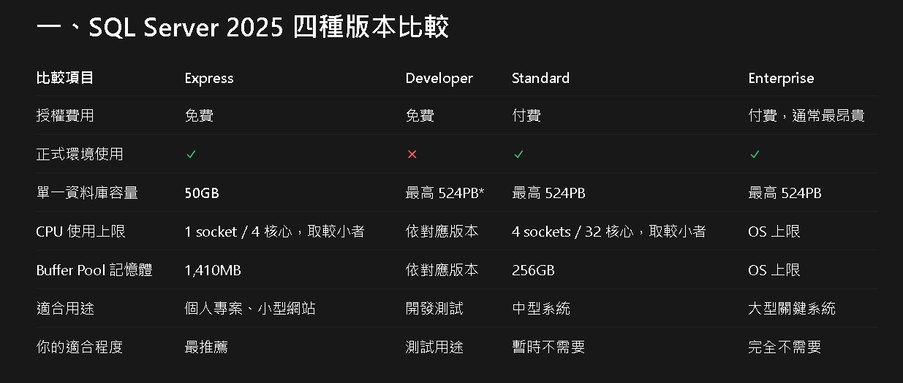
<br/><br/>

<h2>Step 2：2025、2022 無法使用的補充原因</h2>
無法直接使用 Sql Server 2025 Express 是因為在 DS720+ 上無法穩定完成初始化，容器會不斷的 Crash。
<br/>主要是出現以下狀況而逐步降級原因：

{:class="table table-bordered"}
| 狀況 | 說明 |
| 1. 記憶體餘裕不足 | NAS DS720+ 原廠只有 2GB RAM，剛好等於 SQL Server on Linux 公布的最低啟動需求
|                  | 並且 NAS 其他套件也會使用記憶體，容器初始化時容易沒有足夠餘裕。 |
| 2. DSM 並非官方列出的 Linux 發行版 | Microsoft 主要驗證 RHEL、Ubuntu 與特定版本的 SLES。Synology DSM 使用自己的 Linux 核心與 Container Manager
|                                 | 因此使用時出現相容性落差。導致不斷 Crash。 |
| 3. NAS 的 Btrfs 格式不被微軟支援 | Microsoft 支援 SQL Server on Linux 使用 XFS 或 ext4。Synology 常用的 Btrfs 不在清單內。 |
| 4. 新版沒有必要收益 | 這次只是約 3GB 的個人資料庫，SQL Server 2019 Express 已能完成匯入與應用程式需求；在 2025、2022 無法穩定啟動時，沒有必要為了版本較新而增加維護風險。 |

<br/>因此 2025、2022 無法穩定啟動，最終在與 NAS DS720+ 版本最相容的 Sql Server 2019 容器下運行

``` Markdown
DS720+ 的 Intel Celeron J4125 是 x86-64、四核心、基礎時脈 2.0GHz，符合 Microsoft 公布的 x64、雙核心與 2GHz Linux 基本需求。

Intel 規格只列出 SSE4.2，沒有 AVX／AVX2；但 Microsoft 並未將 AVX2 列為 SQL Server 2022 或 2025 Linux Container 的一般最低需求。
因此，除非 Log 明確出現 `illegal instruction`，否則不應直接把失敗歸因於 CPU 不支援 AVX2。
``` 

<br/>
<br/>做個小結論：**SQL Server 2025、2022 並非全面不支援 DS720+，而是當前NAS 的 DSM、記憶體、Container Manager 與 Btrfs 組合下無法穩定運作
<br/> 
<br/>※參考資料：<a href="https://global.download.synology.com/download/Document/Hardware/DataSheet/DiskStation/20-year/DS720%2B/enu/Synology_DS720_Plus_Data_Sheet_enu.pdf">Synology DS720+ 規格</a>、<a href="https://www.intel.com/content/www/us/en/products/sku/197305/intel-celeron-processor-j4125-4m-cache-up-to-2-70-ghz/specifications.html">Intel J4125 規格</a>、<a href="https://learn.microsoft.com/en-us/sql/linux/install-upgrade/setup">SQL Server on Linux 系統需求</a>
<br/><br/>


<br/><br/>
<h1>第三部分：建立 NAS 上的 Sql Server 2019 Docker Container</h1>

<h2>Step 1：NAS 操作 - 建立 Docker Compose 檔案</h2>
本次使用 SQL Server 2019 Express，並將 NAS 的 `14334` 對應到容器內的 `1433`。
<br/>先進入 NAS Server 建立 docker-compose.yml：

``` yaml
services:
  sqlserver2019:
    image: mcr.microsoft.com/mssql/server:2019-latest
    container_name: sqlserver2019-new
    hostname: sqlserver2019
    restart: unless-stopped

    environment:
      ACCEPT_EULA: "Y"
      MSSQL_PID: "Express"
      MSSQL_SA_PASSWORD: "${MSSQL_SA_PASSWORD:?Set password in env}"
      MSSQL_MEMORY_LIMIT_MB: "3072"
      TZ: Asia/Taipei

    ports:
      - "14334:1433"

    volumes:
      - sqlserver2019_fresh_data:/var/opt/mssql

    mem_limit: 4g

    stop_grace_period: 60s

volumes:
  sqlserver2019_fresh_data:
    name: sqlserver2019_fresh_data_20261110

```

<br/>※重要： `/var/opt/mssql` 存放 SQL Server 的資料檔、Log 與系統資料庫，必須掛載持久化 Volume；否則刪除容器時可能連資料一起消失。
<br/>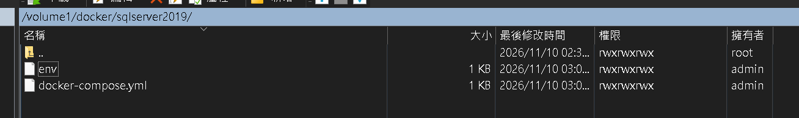
<br/><br/>

<h2>Step 2：NAS 操作 - 建立 env 檔案保存容器密碼</h2>
在相同目錄建立 env：

``` dotenv
MSSQL_SA_PASSWORD=請放入符合複雜度的密碼
```

<br/>這可避免密碼直接寫在 Compose 或公開的 Repository 中。`MSSQL_SA_PASSWORD` 是目前使用的變數名稱，舊的 `SA_PASSWORD` 已棄用。
<br/>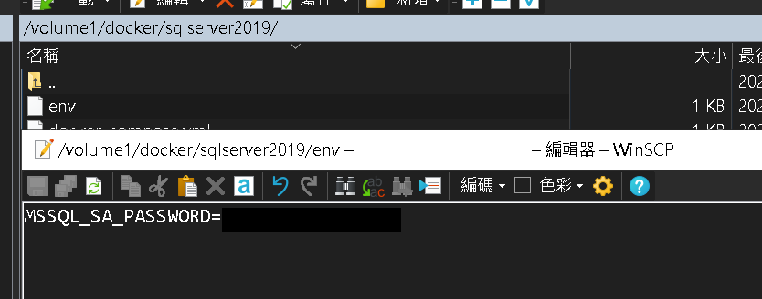
<br/><br/>

<h2>Step 3：NAS操作 - 啟動 SQL Server 2019</h2>
在 Compose 檔案所在目錄執行：

``` shell
docker compose --env-file env up -d
```


<br/>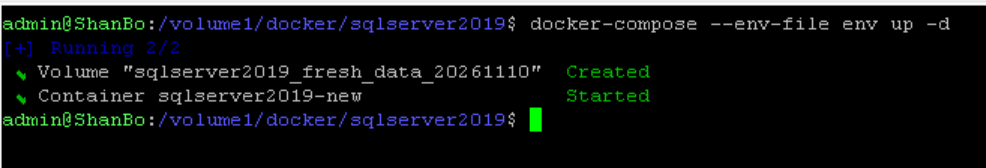
<br/><br/>
<br/>確認容器不會啟動後立刻退出，而且容器保持 Running 沒有 Crash。
<br/>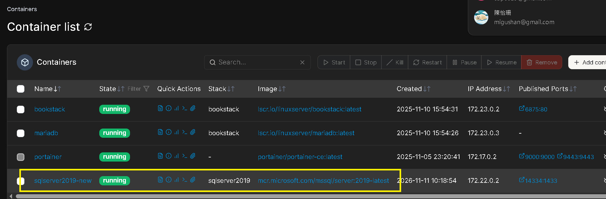
<br/><br/>


<br/><br/>
<h1>第四部分：SqlPackage 匯出與匯入 BACPAC</h1>

<h2>Step 1：停止來源資料庫的寫入</h2>
SqlPackage Export 會將資料庫結構與資料寫入 BACPAC。為了避免長時間匯出期間仍有新增或修改，應先停止排程、背景服務及應用程式寫入。
<br/>否則 BACPAC 只是匯出當下取得的資料，不會在之後自動同步 Azure 與 NAS。
<br/><br/>

<h2>Step 2：安裝 SqlPackage</h2>
確保自己電腦本機有 SqlPackage ，通常在 Windows 以下目錄路徑：

``` Markdown
C:\Program Files\Microsoft SQL Server\170\DAC\bin\SqlPackage.exe
```

<br/>若無 SqlPackage 則是要先下載，<a href="https://learn.microsoft.com/zh-tw/sql/tools/sqlpackage/sqlpackage-download?view=sql-server-ver17&source=recommendations#installation-file-download-alternative">連結</a>
<br/>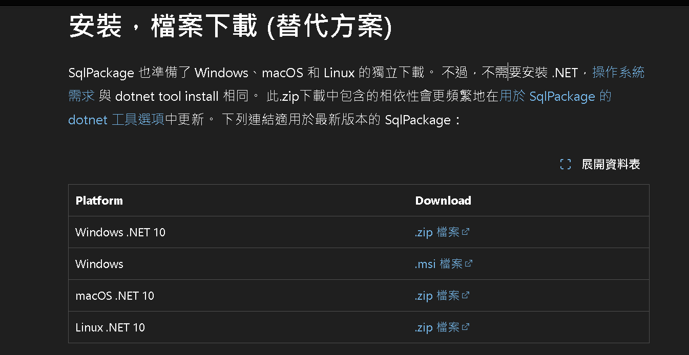
<br/><br/>

<h2>Step 3：從 Azure SQL Database 匯出</h2>
如果 Azure SQL 已設定 Microsoft Entra 登入，建議使用互動驗證，避免將密碼直接放入指令：
<br/>※TargetFile 是輸出位置

``` powershell
SqlPackage /Action:Export `
  /SourceServerName:"你的 Azure 連接位址" `
  /SourceDatabaseName:"你的 Azure 資料庫名稱" `
  /SourceUser:"你的Azure SQL帳號" `
  /TargetFile:"D:\SQLBackup\StockCounter.bacpac"
```

<br/>執行後，會有以下畫面
<br/>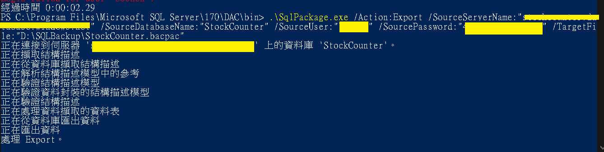
<br/><br/>
<br/>
<br/>本次約 3GB 的 Azure SQL Standard S0，匯出約 4 小時。S0 僅有 10 DTU，加上資料讀取、序列化、壓縮與網路傳輸，匯出時間比預期更久。
<br/>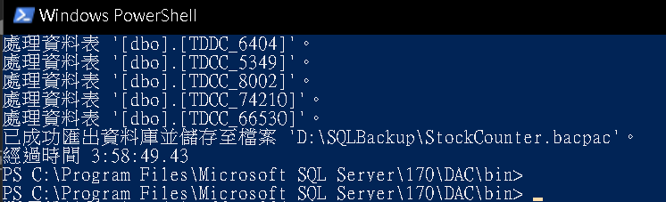
<br/><br/>

<h2>Step 4：匯入 NAS SQL Server - 確認腳本</h2>
因為 SQL Server 剛建立，因此可以執行匯入(不會有碰撞同名資料表問題)：

``` powershell
# SqlPackage 路徑
$SqlPackage = "C:\Program Files\Microsoft SQL Server\170\DAC\bin"

# BACPAC 路徑
$Bacpac = "D:\SQLBackup\StockCounter.bacpac"

# 確認工具與備份檔存在
Test-Path $SqlPackage
Test-Path $Bacpac

```

<br/>先進行測試確保資料都存在
<br/>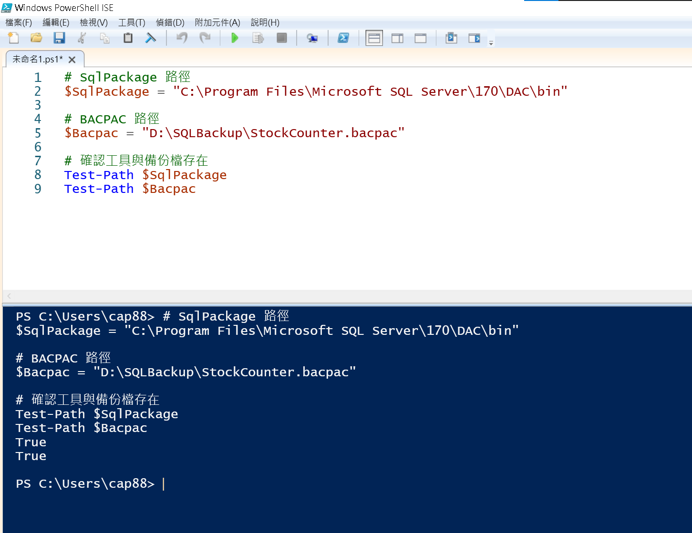
<br/><br/>


<h2>Step 5：匯入 NAS SQL Server - 執行腳本</h2>
因為 SQL Server 剛建立，因此可以執行匯入(不會有碰撞同名資料表問題)：

``` powershell
$SecurePassword = Read-Host "請輸入 NAS SQL Server SA 密碼" -AsSecureString

$bstr = [Runtime.InteropServices.Marshal]::SecureStringToBSTR($SecurePassword)

try {
    $Password = [Runtime.InteropServices.Marshal]::PtrToStringBSTR($bstr)

    & $SqlPackage `
      /Action:Import `
      "/SourceFile:$Bacpac" `
      "/TargetServerName:您的NAS位址,14334" `
      "/TargetDatabaseName:StockCounter" `
      "/TargetUser:sa" `
      "/TargetPassword:$Password" `
      /TargetEncryptConnection:True `
      /TargetTrustServerCertificate:True `
      /TargetTimeout:60
}
finally {
    [Runtime.InteropServices.Marshal]::ZeroFreeBSTR($bstr)
    Remove-Variable Password -ErrorAction SilentlyContinue
    Remove-Variable SecurePassword -ErrorAction SilentlyContinue
}


```

<br/>可貼在測試腳本下方，再次執行
<br/>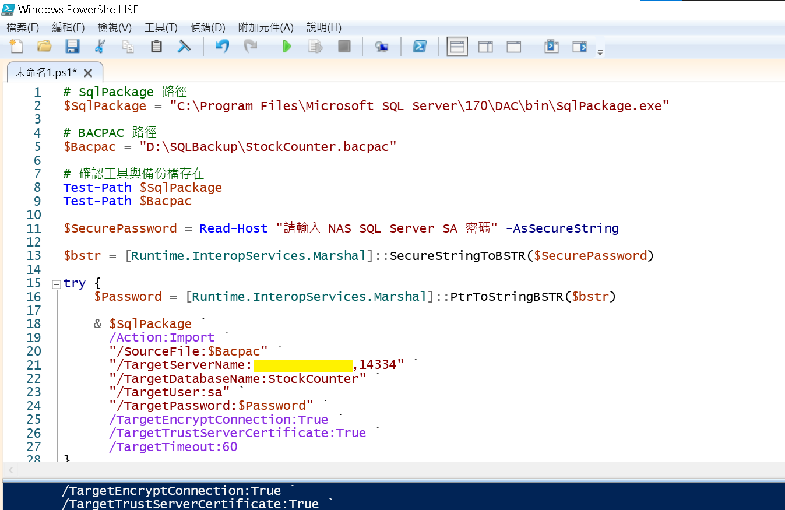
<br/><br/>
<br/>執行後，跳出提示輸入 MSSQL 2019 資料庫 SA 密碼
<br/>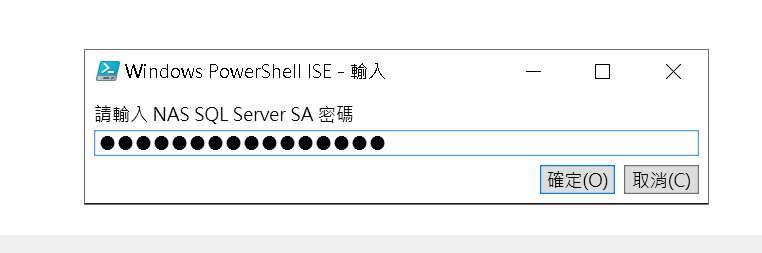
<br/><br/>
<br/>開始執行，需要時間等待
<br/>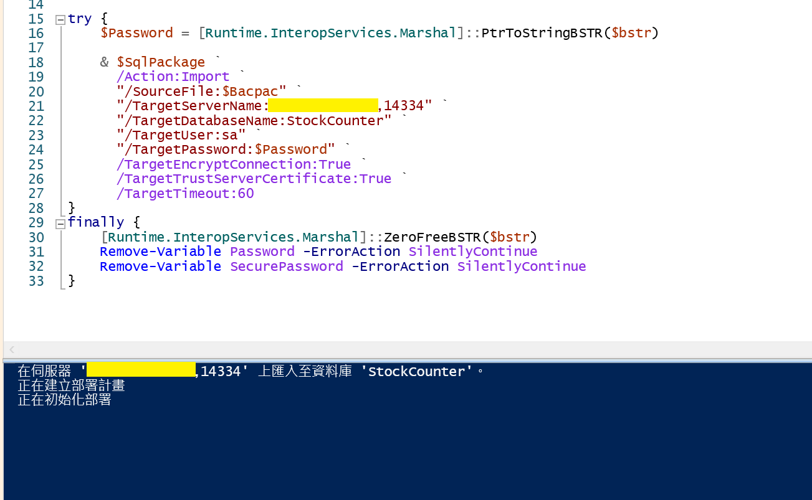
<br/><br/>
<br/>本次匯入約 38 分鐘完成，明顯快於匯出約 4 小時。
<br/>這不代表所有環境都是 Import 比 Export 快；差距也可能來自 Azure S0 資源限制、網路、壓縮、批次寫入與索引建立方式。
<br/>※補充 SqlPackage 官方參數：<a href="https://learn.microsoft.com/en-us/sql/tools/sqlpackage/sqlpackage-export">Export</a>、<a href="https://learn.microsoft.com/en-us/sql/tools/sqlpackage/sqlpackage-import">Import</a>
<br/>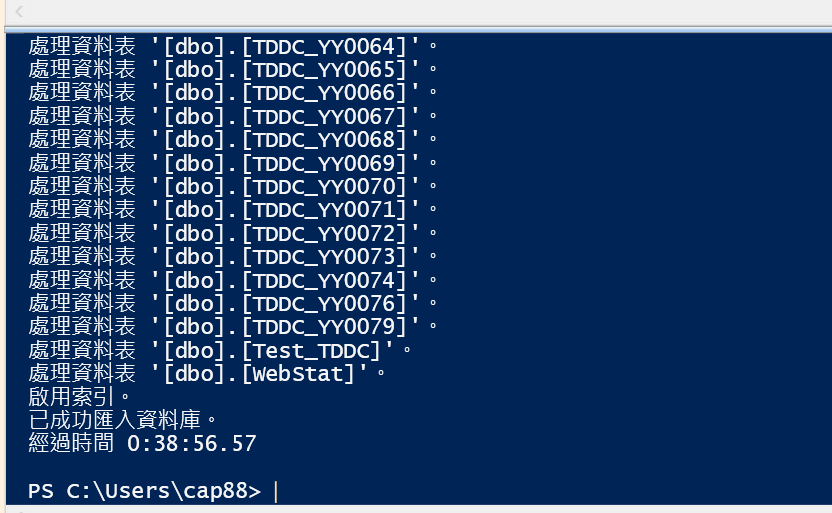
<br/><br/>
<br/>※確認執行過程中 NAS 都是保持正常的 CPU 記憶體運行狀態
<br/>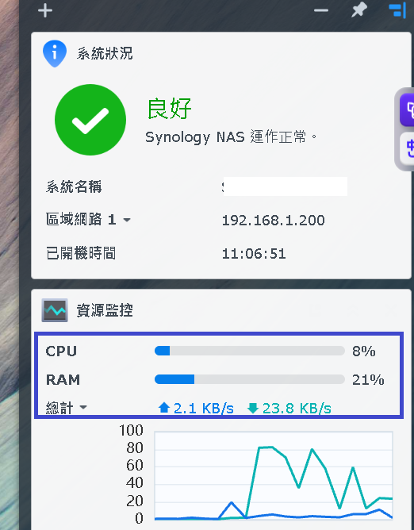
<br/><br/>


<br/><br/>
<h1>第五部分：HeidiSQL 連線驗證資料</h1>

<h2>Step 1：可能問題 - 使用 HeidiSQL 登入時憑證鏈不受信任</h2>
資料匯入後，嘗試用 HeidiSQL 可能出現：

``` Markdown
與伺服器的連接已成功建立，但在登入程序時發生錯誤。
(provider: SSL Provider, error: 0 - 此憑證鏈結是由不受信任的授權單位發出的。)
```

<br/>這表示 TCP 連線已建立，失敗點是 TLS 憑證驗證。SQL Server 容器沒有配置受信任憑證時，通常會使用自簽憑證；新版驅動程式提高預設加密要求後，更容易遇到此問題。
<br/>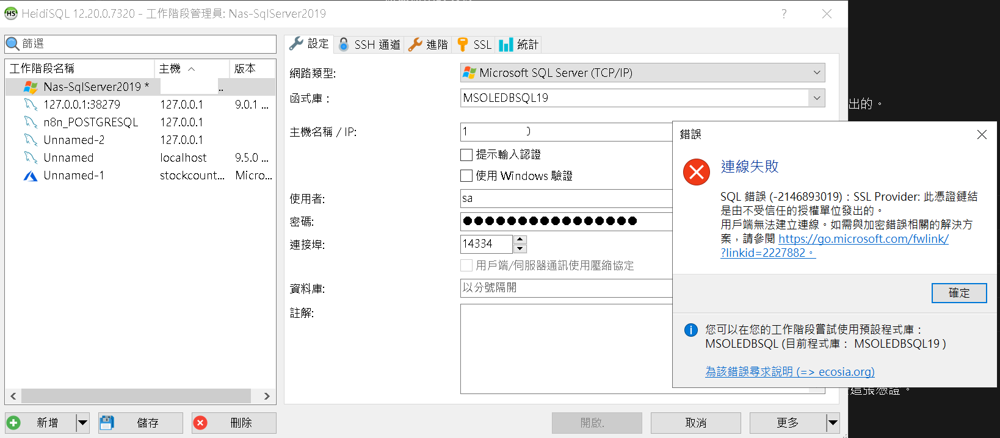
<br/><br/>

<h2>Step 2：排除方法 - 處理 HeidiSQL 與應用程式連線</h2>
本次 HeidiSQL 使用新版 OLE DB Provider 時遇到憑證問題，改用 Microsoft OLE DB Driver 18 可作為過渡排查方式。
<br/>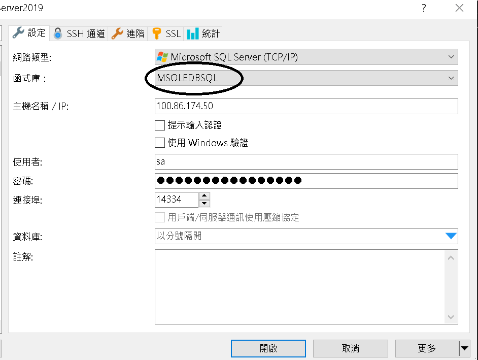
<br/><br/>
<br/>
<br/>微軟的 OLE DB Driver <a href="https://learn.microsoft.com/en-us/sql/connect/oledb/release-notes-for-oledb-driver-for-sql-server?view=sql-server-ver17#1876">18.7.6 下載頁面</a>
<br/>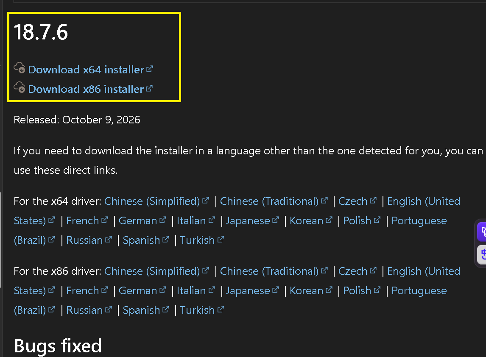
<br/><br/>


<h2>Step 3：排除方法 - 代碼端的對應調整</h2>
我這邊是用 C# + SqlClient，因此我的調整方式是在 Connection String 加入：

``` text
Encrypt=True;TrustServerCertificate=True;
```

<br/>`TrustServerCertificate=True` 會略過伺服器憑證身分驗證，適合受控內網或 VPN 的過渡使用。
<br/>※若資料庫會開放到其他網路環境，應配置用戶端可驗證的正式 TLS 憑證。
<br/>※這一段只處理驅動程式與 TLS 連線；資料庫帳號及權限範圍應依每個系統的實際需求自行規劃。
<br/>Microsoft 文件：<a href="https://learn.microsoft.com/en-us/troubleshoot/sql/database-engine/connect/certificate-chain-not-trusted">Certificate chain not trusted after driver upgrade</a>
<br/><br/>

<h2>Step 4：登入 HeidiSQL 驗證資料</h2>
最後登入 HeidiSQL 就可順利驗證資料是否有順利匯入成功
<br/>※驗證方式應自行生成對應的資料表 SQL 來進行一致性驗證 
<br/>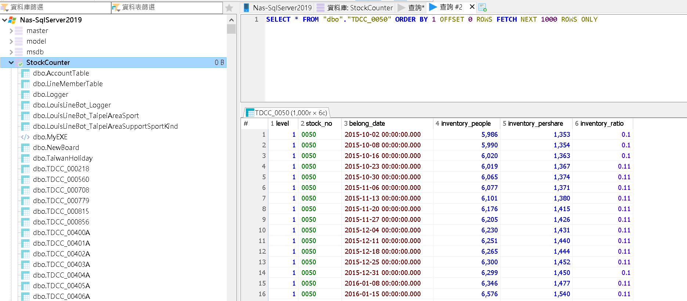
<br/><br/>


<br/><br/>
<h1>第六部分：正式切換、Azure 停費與注意事項</h1>

<h2>Step 1：確保程式端資料寫入地端 NAS 成功</h2>
接著調整原本的程式碼，確保從雲端資料庫轉移到地端資料庫後程式工作仍然正常
<br/>以下確保我程式的集保戶資料資料寫入最新資料正確，並且一致。
<br/>那麼下一步就是停用 Azure 雲上資料庫
<br/>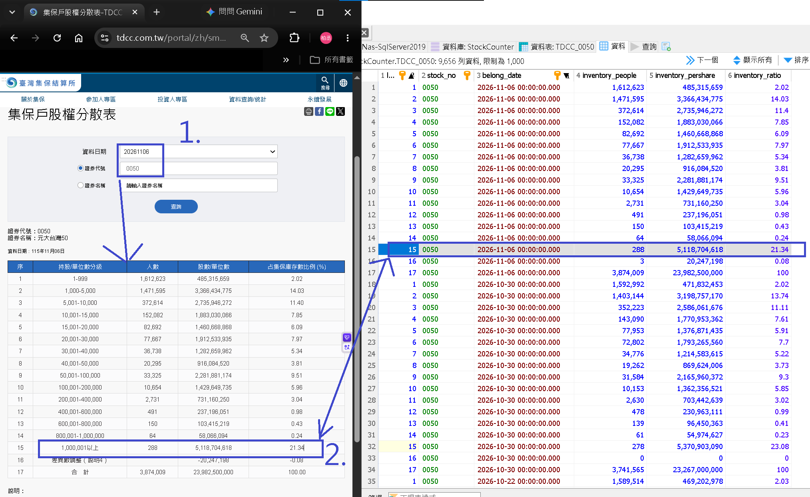
<br/><br/>

<h2>Step 2：正式切換前的必要確認</h2>
必要確認：

``` Markdown
1. 主要資料表與近期資料存在。
2. 原本的程式可以從 NAS 讀取及寫入。
3. 容器重新啟動後資料仍存在。
4. 所有排程與程式都已改用 NAS Connection String，不再寫入 Azure。
```

<br/>基本確認完成後，接著正式切換。
<br/><br/>

<h2>Step 3：進入 Azure 雲服務 - 刪除服務</h2>
登入 Azure Portal -> Azure SQL 資料庫 
<br/>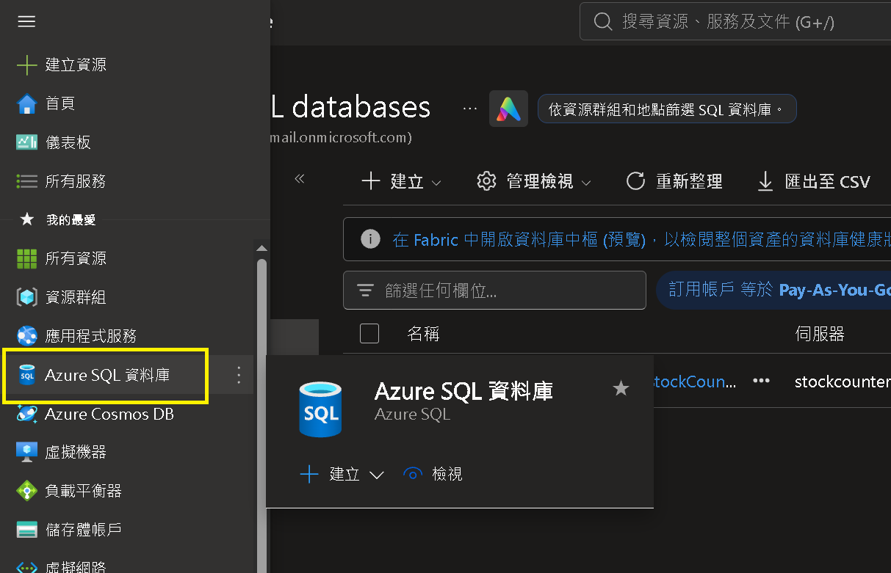
<br/><br/>
<br/>選擇設定 -> 刪除
<br/>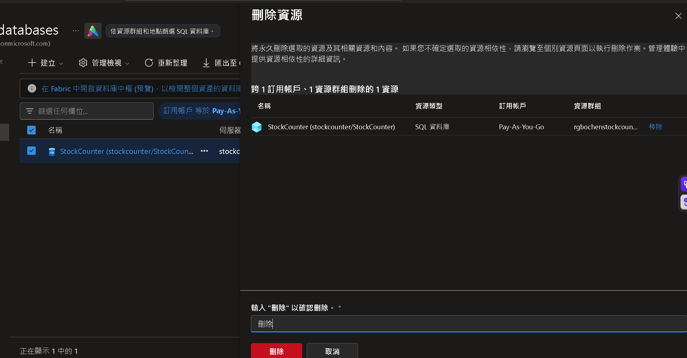
<br/><br/>
<br/>確認刪除完成
<br/>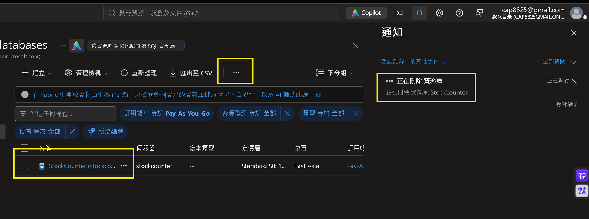
<br/><br/>


<h2>Step 4：Azure SQL Standard S0 如何停止計費？</h2>
Standard S0 是固定配置的 DTU 方案。停止程式連線、關閉防火牆或暫時不使用， **都不會停止資料庫的固定費用。**
<br/>因此 NAS 遷移與確認後，不再需要 Azure 的資料庫，就必須刪除 Azure SQL Database 來停止收費：
<br/><br/>

<h2>Step 5：整理本次遷移的重點</h2>

``` Markdown
1. Synology NAS 不一定適合直接使用最新 SQL Server Image；先確認 Container Log 與 RestartCount。
2. `/var/opt/mssql` 必須掛載持久化 Volume，否則重新建立容器可能遺失資料。
3. Synology Btrfs 不在 SQL Server on Linux 官方支援的檔案系統範圍內。
4. Azure S0 匯出速度可能受 DTU 限制，3GB 匯出 4 小時不代表 SqlPackage 異常。
5. OLE DB 或 SqlClient 的 TLS 預設值可能造成憑證鏈錯誤。
6. Azure SQL Standard S0 沒有停止後不計費的功能；不再使用時要刪除資料庫。
7. SQL Server Express 單一資料庫上限為 10GB，遷移前要先確認目前大小與未來成長量。
```

<br/>本次最後以 SQL Server 2019 Express 完成 BACPAC 匯入、應用程式切換與 Azure 資源移除。
<br/>對資料量不大、可自行維護 NAS 的個人服務而言，這是一個可行方案；
<br/>真正需要注意的不是 Docker 指令本身，而是 **版本相容性、持久化 Volume、Btrfs 支援狀態、TLS 與 Express 容量上限。**
<br/><br/>
