<div class="summary">
<br/>應用所需：1. 已使用 Jekyll 建置、部署到 GitHub Pages 的部落格
<br/>&emsp;&emsp;&emsp;&emsp;&emsp;2. 本機可執行 Ruby 與 Bundler，並能調整 GitHub repository 的 Pages 設定
<br/>&emsp;&emsp;&emsp;&emsp;&emsp;3. 若要提交 Sitemap，需有該網站的 Google Search Console 權限
<br/>解決問題：1. 每次建置自動產生 sitemap.xml，省去手動更新
<br/>&emsp;&emsp;&emsp;&emsp;&emsp;2. 同時支援推送後部署與台灣時間每週六定時發文
<br/>&emsp;&emsp;&emsp;&emsp;&emsp;3. 排查 cannot load such file -- jekyll-sitemap，以及 Ubuntu 26.04 runner 被判成 self-hosted 的錯誤
<br/>相關參考：<a href="https://gotoa1234.github.io/2024/05/05/1.html">0009. 快速使用 Jekyll 搭建自己的部落格</a>
<br/>基本介紹：本篇分為五大部分。
<br/>第一部分：原本的發布流程與改造目標
<br/>第二部分：Sitemap 插件 - 如何設定與排查 Bundler LoadError
<br/>第三部分：GitHub Actions - 設定推送與週六排程
<br/>第四部分：遭遇問題 - 排查 Ubuntu 26.04 runner 相容問題
<br/>第五部分：重新提交 Google Search Console
</div>

<div class="title">
    <br/><hr class="titleinner">
    <span></span>
    <hr class="titleinner"><br/>
</div>

<h1>第一部分：原本的發布流程與改造目標</h1>

<h2>Step 1：原本推送就會發布，為什麼還需要排程？</h2>
這個部落格原先由 GitHub Pages 從 `main` 分支建置。
<br/>當我每次推送文章，GitHub 就會跑一筆 `pages build and deployment` , `sitemap.xml` 則是另外產生的靜態檔，文章更新後要記得把新網址加進去。

``` Markdown
目的：希望平日可以先把文章寫好並推送，週六當天由 GitHub 自動發布。
同時，平常修正舊文章時，仍然可以靠一次推送更新網站。
```

{:class="table table-bordered"}
| 項目 | 本次使用的環境或設定 |
| --- | --- |
| 本機建置 | Windows、Ruby 2.7、Jekyll 4.2.2、Bundler |
| 網站來源 | GitHub repository 的 `main` 分支 |
| 發布方式 | GitHub Pages，使用自訂 GitHub Actions workflow |
| 排程時間 | 台灣時間每週六 09:17 |
| 建置輸出 | HTML、`sitemap.xml`|


<h2>Step 2：未到日期的文章由 Jekyll 在建置時排除</h2>

我原本在首頁用日期過濾最新文章，但歷史文章、主題分類和 Lunr 索引是直接讀取 `site.posts`。
<br/>如果全站設成 `future: true`，未來日期的文章仍可能在建置時被產生，並出現在這些地方。
<br/>因此未來的文章不發布，先把 `_config.yml` 的全站設定改成：

```yaml
future: false
```

<br/>只設定 `future: false` 時，時間到了還要有一次新的建置，因此需要新增 Github Action 週六的排程。
<br/>因此本篇介紹說明以下內容：

{:class="table table-bordered"}
| 1. 即使先簽入了未來的文章，因設定 future: false 避免先顯示出來 |
| 2. 手動 Sitemap.xml 引用 Jekyll Sitemap Pluging 自動建立 |
| 3. Github Actions 如何自動化週六建置 |
| 4. 上述的遭遇問題排除 |


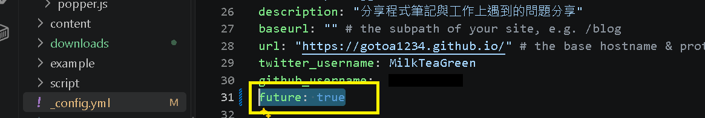

<h1>第二部分：Sitemap 插件 - 如何設定與排查 Bundler LoadError</h1>

<h2>Step 1：將 jekyll-sitemap 加入 Gemfile 和 _config.yml</h2>
1. 首先參考 Jekyll 官方的<a href="https://github.com/jekyll/jekyll-sitemap">說明</a>
<br/>
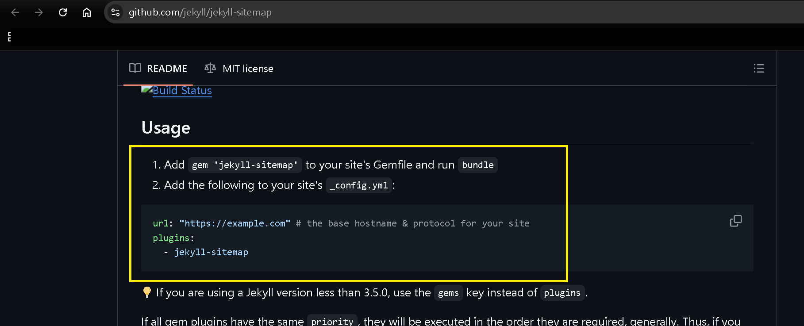
<br/><br/>
<br/>2. 在 `_config.yml` **既有的** `plugins:` 清單加入 `jekyll-sitemap`。以下是我這個專案的設定片段：

```yaml
url: "https://gotoa1234.github.io/"
future: false

plugins:
  - jekyll-feed
  - jekyll-seo-tag
  - jekyll-sitemap
```

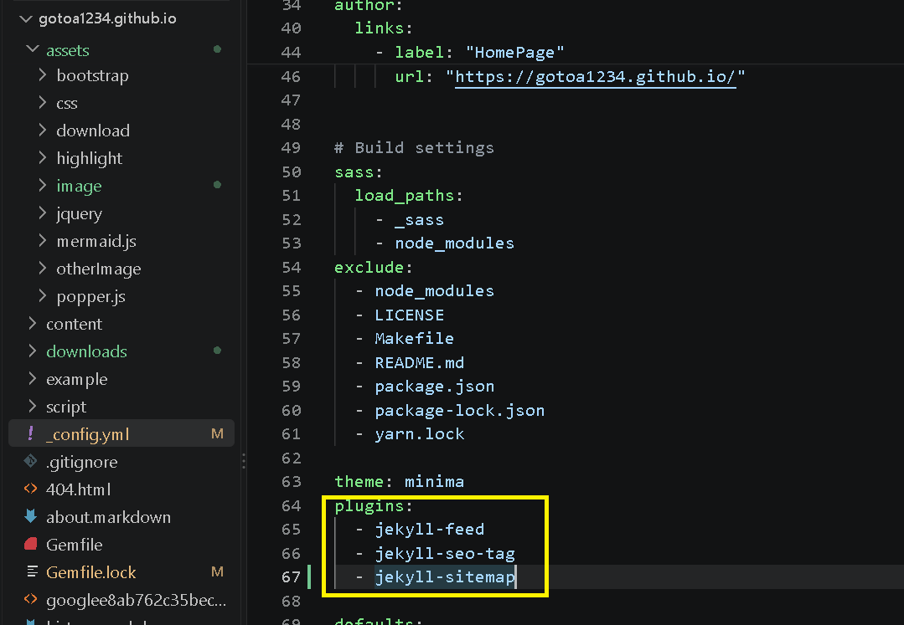
<br/><br/>
<br/>3. 然後在專案根目錄的 `Gemfile`，找到既有的 `jekyll_plugins` 區塊並加入外掛：

```ruby
group :jekyll_plugins do
  gem "jekyll-feed", "~> 0.12"
  gem "jekyll-sitemap"
end
```

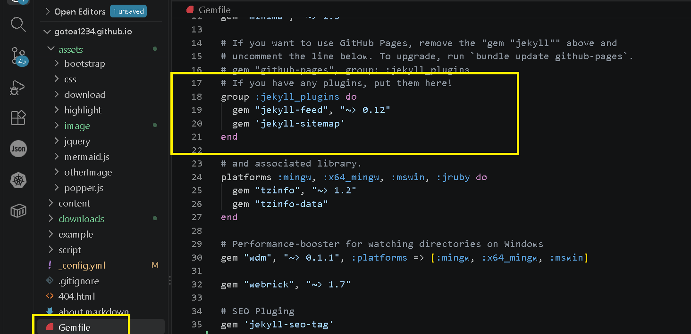
<br/><br/>
<br/>4. 原本手動維護的 `sitemap.xml` 從專案根目錄移除。
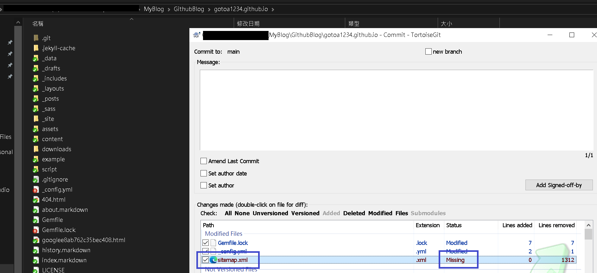
<br/><br/>


<h2>Step 2：踩坑一 - 裝過 gem，bundle exec 為什麼找不到？</h2>
我在本機執行 `bundle exec jekyll serve` 時，Jekyll 已經讀到 `_config.yml`，但載入外掛時出現：

```text
Dependencv Error: Yikes! lt looks like you don't have jekyll-sitemap or one of ites dependencies installed. 
In order to use Jekyll as currently configured, you'll need to install this gem. If you've run Jekyll with `bundle exec`,
ensure that you have included the jekyll-sitemap gem in your Gemfile as well. The full error message from Ruby is 'cannot load such file -- jekyll-sitemap'
If you run into trouble, you can find helpful resources at https://jekyllrb.com/help/!

....略
```

<br/>大意是說 **缺少文件，但實際上我們確實有安裝套件**，但卻沒有自動生成
<br/>
<br/>因此繼續延伸排查 - 可以在專案根目錄用以下指令交叉確認：

```powershell
gem list --local --exact jekyll-sitemap
bundle exec ruby -rbundler -e "puts Bundler.default_gemfile"
bundle info jekyll-sitemap
```

<br/>這次 `gem list` 有列出 `jekyll-sitemap 1.4.0`，但 Bundler 當下使用的 `Gemfile` 和 `Gemfile.lock` 裡都沒有它。
<br/>也就是說，Ruby 環境已安裝外掛，這個專案的相依套件清單卻還沒包含它。
<br/>
<br/>官方缺少的一個步驟如下，就是執行：

```powershell
bundle install
```

<br/>`bundle install` 會同步 `Gemfile.lock`。
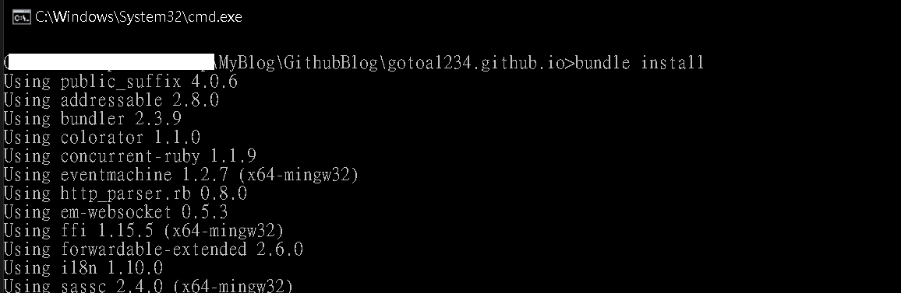
<br/><br/>
<br/>最終就會發現 Sitemap 有順利自動生成，並且可以執行以下指令啟動 Jekyll

```powershell
bundle jekyll exec serve 
```

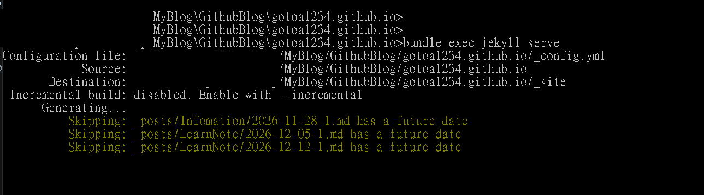
<br/><br/>
<br/>並且 Sitemap 也已經順利生成(對應第二部分 Step1. 的第4部手動刪除舊的 sitemap.xml 才會順利生成)
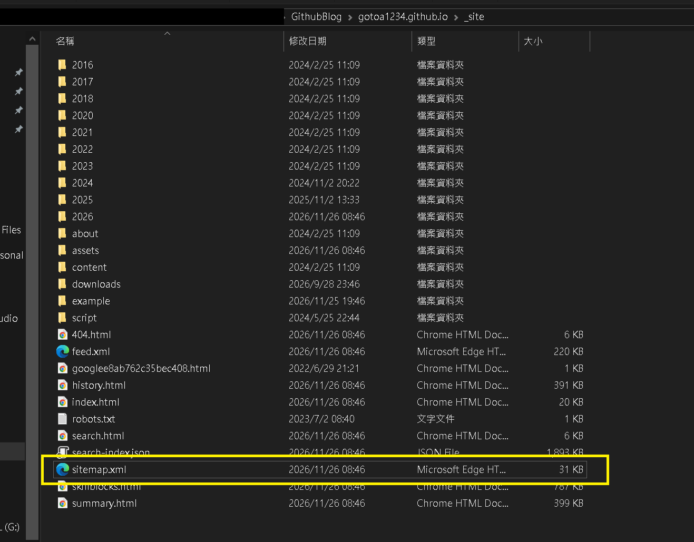
<br/><br/>


<h1>第三部分：GitHub Actions - 設定推送與週六排程</h1>

<h2>Step 1：選擇 GitHub Pages 的發布來源</h2>
若只需要「推送時更新 Sitemap」，GitHub Pages 的 **Deploy from a branch** 已支援 `jekyll-sitemap`。 
<br/>**這次要讓週六沒有推送也能重新建置**
<be/>因此：我在該 Jekyll 的 repository 選擇 **Settings → Pages → Build and deployment → Source → GitHub Actions**。
<br/>※是在 Settings 而非 Actions，通常設定好後很少異動，容易找不到真正 Github Actions 設定位址。 
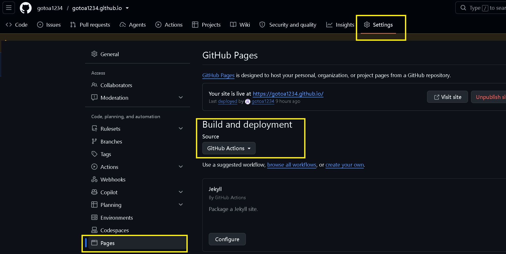
<br/><br/>

<br/>然後選擇新增 **Configure** ，這時 GitHub 會提供 Jekyll 範本。
<br/>按 **Configure** 後會進入 YAML 編輯器，提交到 `main` 後，才會有 repository 自己的 `.github/workflows/jekyll.yml`。
<br/>切換發布來源後，由這份 workflow 接手網站發布，所以要在同一份檔案裡設定 `push` 才能維持原本的發文習慣。
<br/>[GitHub Pages 發布來源設定](https://docs.github.com/en/pages/getting-started-with-github-pages/configuring-a-publishing-source-for-your-github-pages-site) · <br/>[GitHub Pages 支援套件](https://pages.github.com/versions/)


<h2>Step 2：用同一份 workflow 處理三種觸發</h2>

以下是我整理後的 `.github/workflows/jekyll.yml`。它採用含預裝套件的 `actions/jekyll-build-pages`
<br/>建置成功後會先檢查這個部落格的兩份索引檔，再上傳並部署 `_site`。


```yaml
name: Deploy Jekyll site to Pages

on:
  push:
    branches: ["main"]
  schedule:
    - cron: "17 9 * * 6"
      timezone: "Asia/Taipei"
  workflow_dispatch:

permissions:
  contents: read
  pages: write
  id-token: write

concurrency:
  group: pages
  cancel-in-progress: false

jobs:
  build:
    runs-on: ubuntu-latest
    steps:
      - name: Checkout
        uses: actions/checkout@v6

      - name: Setup Pages
        uses: actions/configure-pages@v5

      - name: Build with Jekyll
        uses: actions/jekyll-build-pages@v1
        with:
          source: ./
          destination: ./_site
          future: false

      - name: Verify generated files
        run: |
          test -s _site/sitemap.xml
          test -s _site/search-index.json

      - name: Upload artifact
        uses: actions/upload-pages-artifact@v4
        with:
          path: ./_site

  deploy:
    needs: build
    runs-on: ubuntu-latest
    environment:
      name: github-pages
      url: ${{ steps.deployment.outputs.page_url }}
    steps:
      - name: Deploy to GitHub Pages
        id: deployment
        uses: actions/deploy-pages@v5
```


{:class="table table-bordered"}
| 觸發方式 | 用途 |
| --- | --- |
| `push` | 每次推送到 `main` 都能更新網站 |
| `schedule` | 台灣時間每週六 09:17，使用預設分支當時最新的 commit 重新建置 |
| `workflow_dispatch` | 從 Actions 頁面的 **Run workflow** 手動測試或補跑 |

<br/>最終 Push 時也能正常建置，並且每周六 09:17 也會自動刷新 Sitemap 內容，與發佈符合時間日期的文章
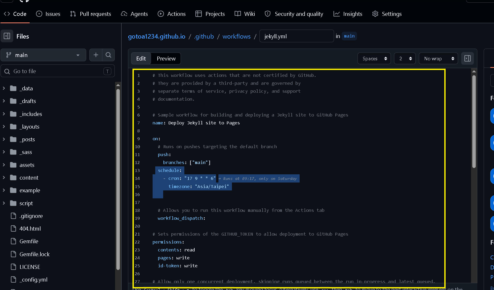
<br/><br/>

<h1>第四部分：遭遇問題 - 排查 Ubuntu 26.04 runner 相容問題</h1>

<h2>Step 1：踩坑二｜新增 jekyll.yml 後，Build 為什麼在 Setup Ruby 失敗？</h2>
第一次提交排程後，`push` 已成功觸發 Actions，但 `build` 很快就失敗，`deploy` 因此被跳過。打開失敗的 Job，摘要中的關鍵訊息是：

```text
The current runner (ubuntu-26.04-x64) was detected as self-hosted
```

當時提交的 `jekyll.yml` 已有排程，但編輯的是 GitHub 產生的 Bundler 版範本。
<br/>它用 `ubuntu-latest`，並把 `ruby/setup-ruby` 鎖定在 `4a9ddd6f338a97768b8006bf671dfbad383215f4`。
<br/>檢查該版本的原始碼後，可以看到它的 Ubuntu 平台清單只到 24.04，所以遇到 GitHub 分配的 26.04 runner 時，會把它判成 self-hosted。
<br/>同一頁也有 Node.js 20 的淘汰警告，這次中止的步驟則是 `Setup Ruby`。
<br/>※補充：[該版本的平台判斷原始碼](https://github.com/ruby/setup-ruby/blob/4a9ddd6f338a97768b8006bf671dfbad383215f4/common.js#L152-L187)

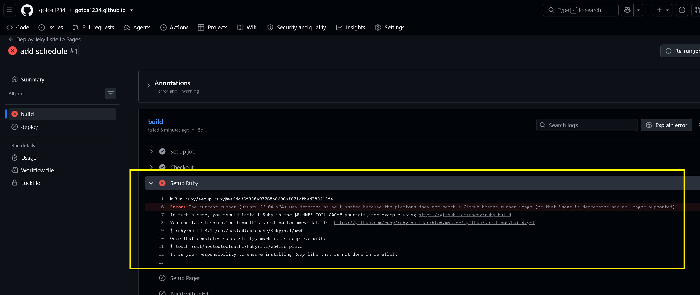
<br/><br/>


<h2>Step 2：改用 GitHub Pages 預裝套件，重新提交同一份 workflow</h2>
這個站使用的 `jekyll-feed`、`jekyll-seo-tag` 和 `jekyll-sitemap` 都在 GitHub Pages 支援清單內，本機的 `Gemfile.lock` 當時也只鎖定了 Windows 平台。
<br/>因此把原本「Setup Ruby → 安裝專案 gems → 用 Bundler 建置」的步驟，改成第三部分的 `actions/jekyll-build-pages@v1`，直接使用 Pages 的預裝環境。
<br/>本機仍可照原本的方式用 Bundler 預覽。需要在 CI 使用特定 Jekyll 版本或 Pages 清單以外的外掛時，應使用支援 runner 平台的 Ruby 設定，並把 Linux 平台加到專案的鎖定檔。
<br/>
<br/>※懶人包：不能用 Github 上提供的預設 workflow/jekyll.yml 要依照自己環境的配置調整正確的 jekyll.yml 檔案。
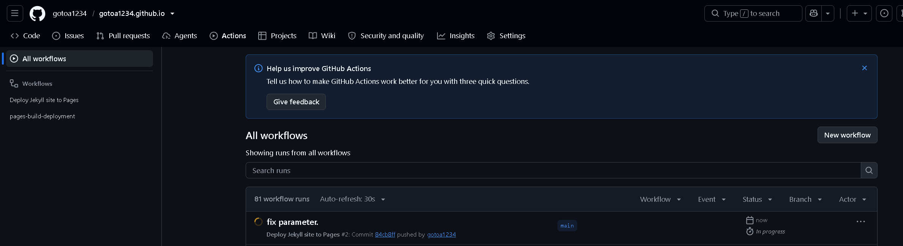
<br/><br/>

<h1>第五部分：重新提交 Google Search Console</h1>

<h2>Step 1：重新提交 Sitemap</h2>
我在本機以 production 環境建置時，已確認能產生 `sitemap.xml` 但 Google Search Console 上的設定並不會即時更新，因此如果需要即時生效，記得去調整  
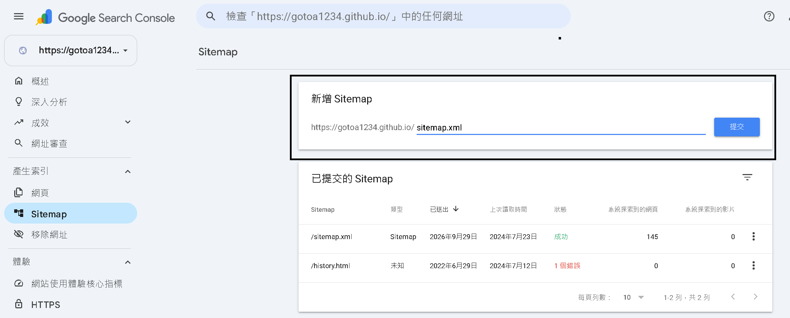
<br/><br/>

