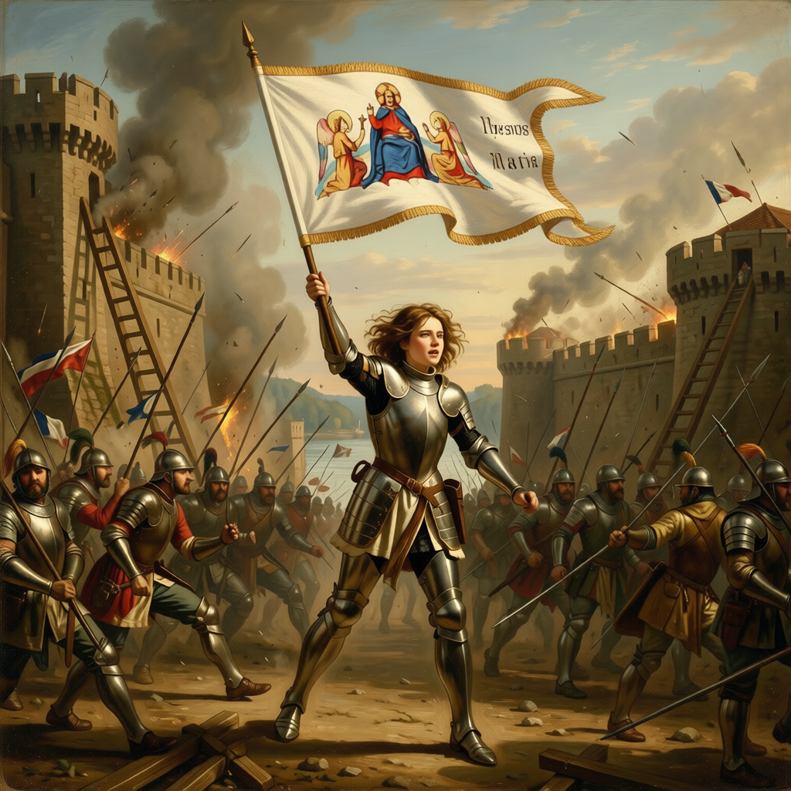
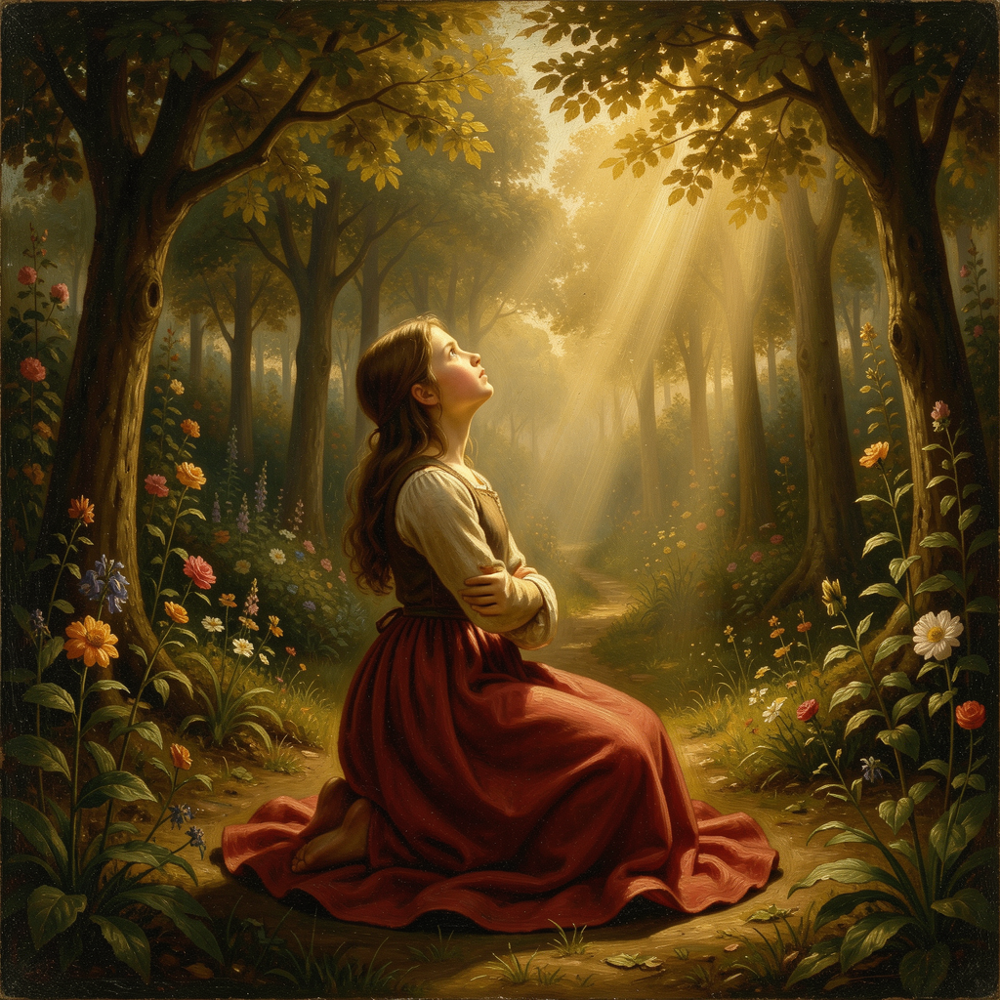
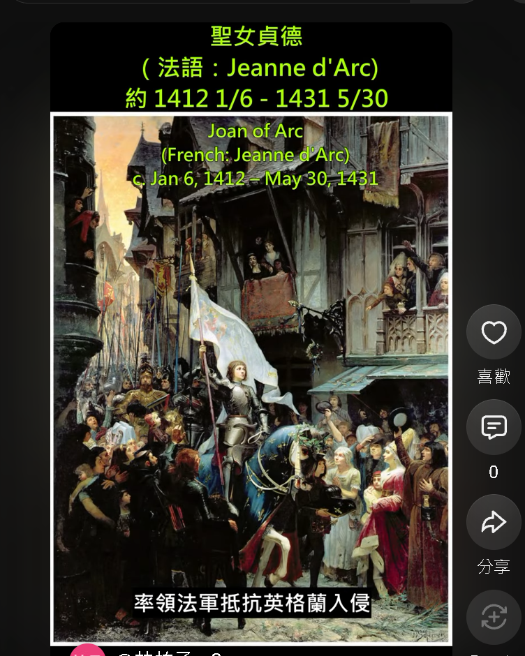

<div class="summary">
<br/>作品名稱：聖女貞德——從奧爾良少女到歷史傳奇
<br/>作品類型：AI 輔助歷史短片／YouTube Short
<br/>影片長度：約 2：44 秒
<br/>畫面比例：9:16，標準 Short 長寬影片
<br/>使用工具：ComfyUI、Qwen-Image-Edit、ControlNet／IP-Adapter、Wan 2.1、LightX2V、GPT-SoVITS、ACE-STEP 1.5
<br/>作品目標：將先前研究的 AI 圖像、影片、聲音與音樂工作流整合，完成一支介紹聖女貞德生平的歷史短片
<br/>YouTube Shorts 成品：<a href="https://youtube.com/shorts/d7AphB0DGus">聖女貞德 Joan of Arc 完整生平｜3 分鐘看懂她的傳奇一生</a>
<br/>基本介紹：本篇分為 3 大部分。
<br/>第一部分：作品介紹
<br/>第二部分：參考文獻
<br/>第三部分：成品瀏覽
</div>

<div class="title">
    <br/><hr class="titleinner">
	<span></span>
	<hr class="titleinner"><br/>
</div>


<br/><br/>
<h1>第一部分：作品介紹</h1>

<h2>Step 1：作品動機</h2>
過去幾篇文章分別研究了 AI 生圖、圖片轉影片、聲音複製與音樂生成，這次想把它們組合成一個完整作品。
<br/>主題選擇 **聖女貞德** ，是因為她短暫的一生同時包含戰爭、信仰、政治、審判與後世平反，很適合使用 Short 的節奏呈現。

``` Markdown
這次不是測試單一模型，而是完成一條可交付的內容製作流程：

歷史資料 → 短片腳本 → 分鏡 → AI 圖像 → 動態影片
        → 旁白 → 音樂／音效 → 字幕 → 剪輯 → YouTube Short
```

<br/><br/>


<h2>Step 2：短片核心敘事</h2>
影片並試圖在 3 分鐘內聚焦闡述聖女貞德人生的幾個轉折，便於讀者快速理解：
<br/>章節大綱：

{:class="table table-bordered"}
| 1. 聖女貞德簡介 | 
| 2. 英法百年戰爭時期介紹 | 
| 3. 1412 - 1424：童年時期 | 
| 4. 1425：聽見上帝的聲音 | 
| 5. 1428 - 1429：開始參軍 | 
| 6. 1429 4/29：解救奧爾良的少女 | 
| 7. 1429 7/16：蘭斯加冕 | 
| 8. 1430 5/23：支援貢比涅城被俘虜 | 
| 9. 1431 1月：盧昂審判 | 
| 10. 1431 5/30：盧昂火刑 | 
| 11. 1455 ：百年戰爭後 - 家人爭取平反 | 
| 12. 1456 7/7：貞德獲得洗清異端罪刑 | 
| 13. 1920 5/16：梵蒂岡追封為聖人 | 
| 14. 結語：為後世帶來的影響 | 

<br/>敘事角度以「一位年輕女性如何成為時代象徵」為主，避免把複雜戰局簡化成她一人擊敗英軍。
<br/><br/>


<h2>Step 3：使用工具與分工</h2>

{:class="table table-bordered"}
| 階段 | 使用工具 | 用途 |
| :--- | :--- | :--- |
| 資料整理 | 參考網路資源、WIKI 等 | 整理時間線、比對來源與建立腳本 |
| 角色設計 | Qwen-Image-Edit-2509 | 建立貞德主要造型與不同場景版本 |
| 畫風一致 | IP-Adapter Style & Composition | 延續色彩、材質與電影視覺語言 |
| 構圖控制 | ControlNet | 控制人物位置、姿勢與鏡頭骨架 |
| 圖片轉影片 | Wan 2.1 FLF2V | 以首尾幀控制鏡頭起點與結尾 |
| 速度優化 | GGUF + LightX2V LoRA | 在有限 VRAM 下縮短影片生成時間 |
| 中文旁白 | GPT-SoVITS v2 | 產生旁白，音色使用 Common Voice 具 CC-BY-4.0 授權使用的外國人語音檔重新訓練 |
| 配樂 | ACE-STEP 1.5 | 生成無人聲的中世紀電影感配樂 |
| 剪輯字幕 | ShortCut AI Whisper 生成 | 生成後校正，並請 AI 生成相對應的英文字幕與 .srt 檔案 |

<br/>若某段工具與實際成品不同，可將表格中的名稱替換為最後使用版本。
<br/><br/>


<h2>Step 4：相關技術文章</h2>
這次作品主要延伸以下以前分享過的文章 & 工作流：

``` Markdown
角色與畫面：
- Qwen-Image-Edit-2509 多圖融合
- Qwen-Image + ControlNet 單階段合成
- IP-Adapter Style & Composition

動畫：
- Wan 2.1 圖片生成影片
- Wan FLF2V 首尾幀控制
- GGUF + LightX2V 低步數優化

聲音：
- GPT-SoVITS v2 語音複製
- ACE-STEP 1.5 音樂生成
```

<br/>Qwen 多圖融合教學：<a href="https://gotoa1234.github.io/2026/09/05/1.html">0010. Qwen-Image-Edit-2509 多圖融合</a>
<br/>Qwen ControlNet 教學：<a href="https://gotoa1234.github.io/2026/09/12/1.html">0011. Qwen-Image 2509 + ControlNet</a>
<br/>IP-Adapter 教學：<a href="https://gotoa1234.github.io/2026/09/26/1.html">0013. IP-Adapter Style & Composition</a>
<br/>Wan FLF2V 教學：<a href="https://gotoa1234.github.io/2026/08/08/1.html">0007. Wan FLF2V 首尾幀生成影片</a>
<br/>GPT-SoVITS 教學：<a href="https://gotoa1234.github.io/2026/08/22/1.html">0008. GPT-SoVITS v2 語音複製</a>
<br/>ACE-STEP 教學：<a href="https://gotoa1234.github.io/2026/10/03/1.html">0014. ACE-STEP 1.5 音樂生成</a>
<br/><br/>


<h2>Step 5：分鏡設計</h2>
以下為 14 幕的分鏡內容

``` Markdown

- 英法百年戰爭時期 1337 - 1453 年
- 001. 貞德出生時，英法百年戰爭已打了70多年。
       法軍在1415年阿金庫爾之戰，經歷了災難性的慘敗。
       並開啟法國接近「亡國」的黑暗時刻。

- 002. 1412 - 1424：童年-法國東北邊境棟雷米(Domrémy)的農家女
       貞德約1412年生於法國的小村 - 棟雷米。
       父親是有些田產的農民，母親是虔誠信教。她有3個哥哥和1個妹妹。
	   
- 003. 1425年：聽見上帝的聲音
       貞德不識字，成年前協助家務、紡紗、放牧、此類工作，並以虔誠出名。戰爭伴隨她的成長時期。
       貞德13歲時，在父親的院子裡聽到上帝的「聲音」。
	   上帝要求她做2件事：解救被英軍「圍困的奧爾良」與「護送王太子到蘭斯加冕」。

- 004. 1428 - 1429：民間出現「少女救國」預言，並認出王太子(未來的查理七世)
       貞德16歲時，她偽裝男人，到達王太子查理在希農的城堡。
	   據説查理爲了考驗貞德，偽裝混在貴族之中，而未見過彼此的貞德當即認出了王太子。王子准許貞德隨軍。。
	   
- 005. 1429/4/29 ：解救奧爾良的少女
       貞德在戰場上舉著旗幟衝在前面，鼓舞了法軍，也推動將領們採取積極的戰術。
       勝負在9天內分出。這場勝利扭轉了英盛法衰的戰局，貞德從此被稱為「奧爾良的少女」。
	   
- 006. 1429 7/16 ： 法王查理七世於蘭斯加冕
       後續法軍連戰連勝、最終在帕提戰役瓦解了英軍。
	   得以讓貞德支持王太子查理七世於蘭斯加冕，當時貞德手持旗幟站在身旁。
	
- 007. 1429 9/8 法軍進攻巴黎失利
       貞德隨軍進攻巴黎，大腿中了弩箭，查理七世隨即下令撤退並解散軍隊，傾向和勃艮第和談。
	   查理七世在12月時封貞德全家為貴族。

	   
- 008. 1430 5/23 支援貢比涅城被俘虜
       貞德自組一支小部隊，支援被勃艮第軍圍攻的貢比涅城。
	   掩護部隊的貞德無法撤退，當場被勃艮第軍隊俘虜。	   
	   
- 009. 1431 1月 盧昂審判
	   遺憾的是查理七世沒有贖回貞德，被勃艮第賣給英格蘭審判。
	   法庭指控罪行，並讓不識字的貞德簽下公開棄絕書宣判死刑。
	
- 010. 1431 5/30 盧昂火刑
	   年僅19歲的貞德，在盧昂舊市集廣場處以火刑。
	   她要求一個十字架，臨終前反覆呼喚耶穌的名字。
	
- 011. 1455 英法百年戰爭結束後 - 家人爭取平反判決
	   貞德的母親與哥哥們在百年戰爭結束後持續為貞德平反罪刑判決。
	   當時的教宗加理多三世（Callixtus III）重新審理該案。

- 012. 1456 洗刷異端冤案
	   貞德的母親與哥哥們在百年戰爭結束後持續為貞德平反罪刑判決。
	   當時的教宗加理多三世（Callixtus III）重新審理該案。	   

- 013. 1456 7/7 貞德獲得洗清異端罪刑
	   貞德的罪刑案件遍及歐洲各地的許多神職人員一同參加審判。
	   最終宣布貞德的清白，描述貞德是一個為正義犧牲的聖女。
	   
- 014. 1920 5/16 梵蒂岡追封為聖人
	   1920年教宗本篤十五世正式將貞德封為聖女，因而有「聖女貞德」。
	   貞德曾說「為法國而戰」，把國王、國土和信仰連結在一起。
	   後世亦把貞德視為早期法國民族意識的代表人物。

```

<br/>戰爭段落沒有生成長時間近身戰鬥，而是以旗幟、城牆、煙霧與表情傳達壓力，降低 AI 動畫常見的肢體錯位。
<br/>分鏡用圖： **005. 1429/4/29 ：解救奧爾良的少女**，以 IP-Adapter／ControlNet 分別控制畫風與構圖
<br/>
<br/><br/>


<h2>Step 6：角色一致性與歷史視覺</h2>
聖女貞德沒有可供比對的真實照片，後世畫作與雕像也反映不同年代的想像。
<br/>因此本片先建立一份角色設定，再於所有鏡頭延續，而不是宣稱還原她的真實外貌。

``` Markdown
腳色保持深棕色頭髮，身高偏向成人女性...
```

<br/>分鏡用圖： **003. 1425年：聽見上帝的聲音**
<br/>
<br/><br/>


<h2>Step 7：製作配樂</h2>
以下是製作本次的配樂，只提供情緒，不使用現代史詩預告片式重低音蓋過旁白
<br/>成品中仍需對旁白、音樂與音效進行音量平衡，以不影響旁白優先。
<br/>
<br/>ACE-STEP Tags 範例：

``` Markdown
Original emotional melodic orchestral epic for a historical film about Joan of Arc. A breathtakingly beautiful, 
memorable and deeply expressive original heroic main theme, lyrical soaring violins, passionate legato strings, 
noble French horns, warm cellos, delicate medieval harp and subtle vielle. A tender, 
melancholic opening grows into a powerful and majestic symphonic journey. Sweeping melodic phrases, 
rich emotional harmonies, flowing string ostinatos, dramatic crescendos, 
resonant timpani and powerful but restrained orchestral drums. 
Bittersweet minor-key melodies gradually open into radiant, hopeful harmonies. Profound sorrow, 
unwavering courage, spiritual devotion, tragic heroism, dignity, transcendence and enduring hope. 
A magnificent emotional orchestral climax followed by a gentle, luminous resolution. 
Strong melodic development, organic symphonic sound, expressive dynamics, original composition,
purely instrumental, no vocals, no choir, no humming,
no singing, no spoken words, no electronic beats.
```

<br/>
<br/>歌詞部分(只要背景聲)：

``` Markdown
[intro]

[build-up]

[chorus]
[instrumental]

[drop]

[chorus]
[instrumental]

[outro]
```

<br/>
<br/>使用的參數

{:class="table table-bordered"}
| 參數 | 建議起始值 | 作用 |
| :--- | :---: | :--- |
| 每分鐘節拍數 | 125 | 音樂的節奏性較為緊湊  |
| 拍號 | 4 | 四分音符為一拍，每小節有 4 拍。 |
| 調式 | D minor | 情感色彩：陰鬱、悲壯與神聖 |

<br/>
<br/><br/>


<h2>Step 8：AI 內容標示</h2>
本片屬於 AI 輔助歷史視覺化作品，因此在說明欄已加入：

``` Markdown
本片為 AI 輔助製作的歷史短片，部分畫面屬藝術化重建，
並非真實歷史影像，並添加了各時代真實存在的藝術作品當輔助。
```

<br/>
<br/><br/>


<br/><br/>
<h1>第二部分：參考文獻</h1>

<h2>Step 1：主要參考資料</h2>
以下是主要故事、圖片參考文獻：

{:class="table table-bordered"}
| 資料 | 用途 |
| :--- | :--- |
| <a href="https://www.onthisday.com/people/joan-of-arc">Joan of Arc</a> | 歷史上的今天，介紹了貞德的簡要事蹟 |
| <a href="https://zh.wikipedia.org/zh-tw/%E8%81%96%E5%A5%B3%E8%B2%9E%E5%BE%B7">維基百科-聖女貞德</a> | 史料背景、相關藝術作品參考 |
| <a href="https://www.jeanne-darc.info/biography/banner/">Jeanne's Battle Standard and Pennon</a> | 記錄了當時貞德使用的旗幟，並且用 IP-Adapter 替換成該旗幟，讓影片更具真實感 |

<br/>
<br/><br/>


<h2>Step 2：簡化與取捨</h2>
一分鐘影片無法完整處理 Armagnac、Burgundian、英格蘭王權、Troyes 條約及宗教審判的全部關係。

``` Markdown
本片保留部分重要轉機：
- 阿金庫爾戰役導致法國王位危機，甚至差點亡國
- 奧爾良(Orléans) 與 蘭斯(Reims) 的象徵性
- 貢比涅(Compiègne) 被俘
- 盧昂(Rouen) 審判與處刑
- 1456 年撤銷判決及 1920 年封聖

本片省略或簡化：
- 與家族之間的親情互動
- 每場戰役的戰術細節
- 王室與勃艮第派的完整外交關係
- 審判中所有指控與逐日問答
- 後世民族主義、文學與政治形象的演變
```

<br/>因此 Short 中當成歷史的快速輔助影片。
<br/><br/>


<br/><br/>
<h1>第三部分：成品瀏覽</h1>

<h2>Step 1：成品分享 - YouTube Short</h2>
完成影片如下，若嵌入畫面無法播放，可以直接開啟<a href="https://youtube.com/shorts/d7AphB0DGus">聖女貞德 Joan of Arc 完整生平｜3 分鐘看懂她的傳奇一生 #Shorts #history</a>。

<br/>
<div style="text-align:left;">
  <iframe width="315" height="560"
    src="https://www.youtube.com/embed/d7AphB0DGus"
    title="聖女貞德歷史 YouTube Short"
    frameborder="0"
    allow="accelerometer; autoplay; clipboard-write; encrypted-media; gyroscope; picture-in-picture; web-share"
    allowfullscreen>
  </iframe>
</div>
<br/>
<br/>Youtube 上的 Shorts 
<br/>
<br/><br/>


<h2>總結</h2>
《聖女貞德 Joan of Arc 完整生平》是一次將先前 AI 技術文章轉化為實際作品的整合練習。
<br/>AI 負責加速視覺、動畫、聲音與音樂製作，人仍需負責史料核對、敘事取捨、授權確認與最終剪輯。
<br/>所有的成本都是本地化 AI 模型 + 顯示卡完成， **實現零 Token 完成作品。**

``` Markdown
歷史資料提供邊界
AI 工具提供素材
剪輯與敘事決定作品
```

<br/>這也是本次作品最重要的原則：使用 AI 重建歷史氛圍，但不讓生成畫面取代歷史證據。
<br/><br/>
